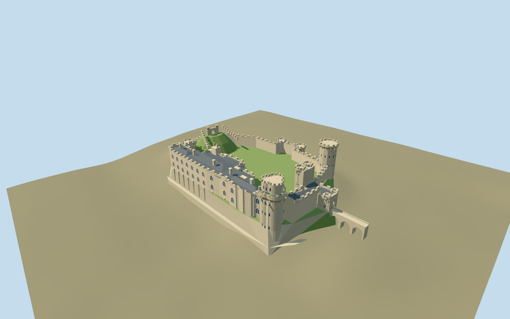

# Warwick Castle

Buff sandstone castle with open courtyard,many-sided Guy tower,lobed two-stage Caesar tower,clocked twin-turret gatehouse and projecting barbican,castellated river ranges with low slate roofs,octagonal western towers and a stepped grassy motte.

## Evidence and reconstruction

Published dimensions and reconstructed details are separated in spec.json. Primary references:

- [Reference](https://www.warwick-castle.com/explore/shows/historical-attractions/towers-ramparts/)
- [Reference](https://historicengland.org.uk/listing/the-list/list-entry/1000386)
- [Reference](https://historicengland.org.uk/listing/the-list/list-entry/1364805)
- [Reference](https://www.warwick-castle.com/media/ixagflho/towers-ramparts.jpg)
- [Reference](https://www.warwick-castle.com/media/dq3h55sp/towers-ramparts.jpg)
- [Reference](https://commons.wikimedia.org/wiki/File:2007-08-26-09095_GreatBritain_Warwick.jpg)
- [Reference](https://commons.wikimedia.org/wiki/File:Warwick_Castle_May_2016.jpg)
- [Reference](https://commons.wikimedia.org/wiki/File:Warwick_Castle_-_Caesar%27s_Tower_2016.jpg)
- [Reference](https://commons.wikimedia.org/wiki/File:Exterior_of_Warwick_Castle_from_across_the_River_Avon,_2009.jpg)
- [Reference](https://commons.wikimedia.org/wiki/File:Warwick_Castle_Gatehouse.jpg)
- [Reference](https://www.openstreetmap.org/relation/553839)

Mapped curtain/domestic/court rings reproduce attributed OpenStreetMap data underODbL-1.0. Other geometry is original approximate authoring. No downloaded mesh,research photograph or unique texture is embedded;three existing shared material graphs supply reusable surfaces.

## Model and axes

8,649 triangles; 25,947 vertices; 5 material groups; 1,041,000 bytes. Native bounds: -84.653, -17.772, -54.876 to 103.000, 34.000, 54.876. Source hash: `sha256:cb18d533e9cbbbfb3c31c5b16db382fbaefae5eb45fd2ed09d3fe94660a33c72`.

{"up":"+Y","lateral":"+X approximately north-east along cached axis;main gate faces +X","longitudinal":"+Z approximately south-east on river/domestic-range side","origin":"Site anchor; Y0 standard PMTiles working datum."}

Two inspected pictures confirm polygonal Guy tower, lobed Caesar tower, clocked twin-turret gatehouse, castellated domestic ranges and stepped motte/ramparts. Retained mapped outline/court and standard viewer PMTiles set approximate location, scale and northeast gate/river-side orientation. A6m downward derivative offset puts the reconstructed court at Y5 above the PMTiles working datum. Bounded lower footing vertices extend below coarse terrain; court, bank and stepped motte remain an explicit approximate reconstruction. Anchor -1.585265184,52.279577946; heading 0.789464883642; standard PMTiles datum 63.38437334827418m. Floors are reconstructed and foundations extend below the coarse sampled ground.

## Reproduce

Run `node packages/worldgen/scripts/generate-signature-towers.mjs --ids=warwick_castle` (or add `--check`). The generator preserves manually edited masters by checking their baseline hashes. Import through the standard authored-model workflow with optimization disabled; then capture all QA cameras, including shared-surface views.

## Pending work

- Approximate current exterior and fit from two inspected pictures and standard viewer PMTiles; no bespoke survey or exact thresholds.
- Detailed original master/hash/recipe preserved. Relative tower-local heights retained; reconstructed court, bank, motte and approach levels are not surveyed ground.
- Three common graphs plus local grass/paving/clock-color and dark recess slots, zero embedded images. No trees, water levels, interiors or terrain cutouts.
- Footprint replacement remains off; physical-device timing unmeasured.

This bundle follows the medium-fi standard. Medium-fi appearance and geographic fit are reviewed separately. Hash-bound visual acceptance is recorded separately after capture inspection.

## Additional geographic data

© OpenStreetMap contributors;Warwick Castle operator;Historic England;primary photographers Gernot Keller,DeFacto and Haydn Curtis.
