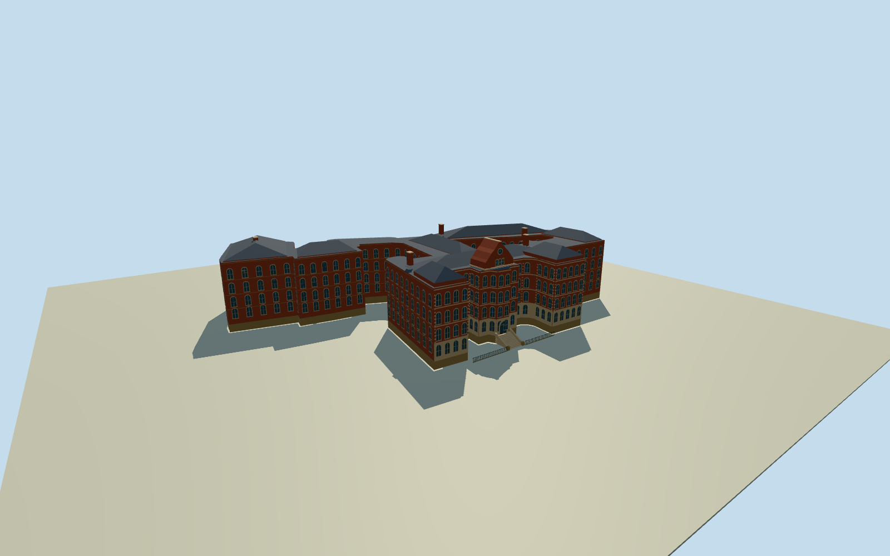

# Adams Building, Nottingham

Red-brick Lace Market warehouse with projecting Italianate bays, pale ashlar dressings, a central staircase and clock gable, and a sequence of dark slate roof ranges around an open court.

Authoring state: **review-in-qa.json**. Current completion evidence is in [qa.json](qa.json) and the [completion ledger](../../../../qualla-structures/batches/qualla-003.PROGRESS.md).

- [Adams Building, Nottingham](https://qualla.com/adams-building-nottingham/)

Two verified public-domain Qualla photographs from April and June 2008 guide the modeled front and rear exterior. Historic England’s written record supplies the E-plan front and the character of the slate roofs, stone dressings and arched windows.

The mapped outline and inner court are retained. The other recesses remain open where the outline turns around them. Heights, roof subdivisions, exact stair and railing positions, and unphotographed walls are proportional estimates.

The independent terrain field is unchanged. Its reference near Stoney Street provides the approximate elevation basis for the entrance steps. Coarse grades are not a survey.

The asset is a dated exterior. Recesses, dressings and ironwork use original geometry and shared materials. No photographic pixels or museum interior details are included.

Build: `node content/worldgen/source/places/gc/gcr/adams_building_nottingham/models/generate-house.mjs`. Add `--check` to verify exact regeneration. 17792 triangles; 6 materials; no embedded photographs.
