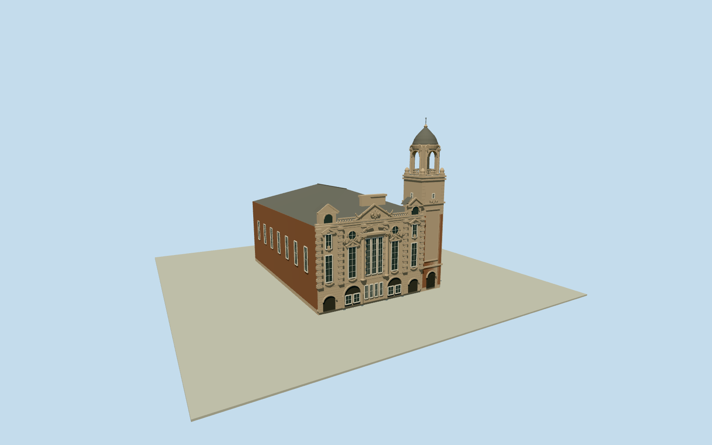

# Albert Hall, Nottingham

Complete native Nottingham Albert Hall: deep brick hall/hipped slate roof, warmbuffterracotta5bayBaroque front with rusticatedpiers, closedcasement/roundwindows, heavycornices/atticdormers/piercedbalustrade, centralIonicaedicule/brokensegmentalpediment/cartouche/festoons; attachedsquare3stagetower/claspingbuttresses/domespinnacles, genuine4openIonicportalrotunda/curvedpediments, closedogeedome/finial;5Diocletianwindows onbrickreturn. Original representative carving; no neighboringPlayhouse/missionhouse outsideparent/interior/streetscape.

Authoring state: **review-in-qa.json**. Current completion evidence is in [qa.json](qa.json) and the [completion ledger](../../../../qualla-structures/batches/qualla-002.PROGRESS.md).

- [Albert Hall, Nottingham](https://qualla.com/albert-hall-nottingham/)

Exact nativeway40324301/Q4710403/NHLE1270608has17distinctparentvertices: original perimeters retained at every master level, no map quantization. Origin is midpoint of original west facade vertices4and12; signed +Xsouth-southwest along facade toward righttower, +Zwest-northwestoutfront. The native polygon is the complete Hall, not an interior parcel or neighboringPlayhouse36977572. Native has no mapped heights/roof partitions: brick/hippedslate/terracottafront/tower details come from inspectedPDoriginals and official listing text, while section heights/roof/tower subdivision and concealed elevations are explicitly inferred.

Three exact already-published Qualla own-workPD/CC0architectural originals inspected, nativeSHA1matched and primary creator releases bound. Fourth2025near-duplicate unused; interiors/organ/unrelatedlandmarks/other-licensed imagery not used. No photographic textures or generated bitmaps; nativegeometry/originalrepresentative carving and sharedPBRsurfaces.

Whole17vertexparent retained with deep brick hall/attached footprint projections and hippedslateroof. Roof ridge/hip partition, front/tower heights, side/rear window subdivisions, concealed return/threshold levels and fine carvings are photographic/primarytext estimates. Main37mfinial height is not surveyed. Original cartouche/festoons/capitals/pediments are medium-fi motifs rather than exact sculptural census or copied lettering.

Four turret portals genuinely open beneath closedconnectedrotundacornice/ogeedome, glazing and gated entries closed with3Dframing. Upperfrontstonebalustrade pierced at nearlevels, simplified distant silhouette. Separate neighboringNottinghamPlayhouse/missionhouse/cathedral and all interiors/streetfixtures/people/landscape excluded.

Independent original source terrain retained, fixed westfront pavement chosen before geometry. No terrain flattening/fitting or replacement footprint, street/threshold slope/host attachment remains approximate preview. Flat review stageY-.7shows architecture, not a surveyed certified sidewalk/contact surface.

Build: `node packages/worldgen/scripts/generate-authored-places.mjs --ids=albert_hall_nottingham`. Add `--check` to verify exact regeneration. 37502 triangles; 6 materials; no embedded photographs.
