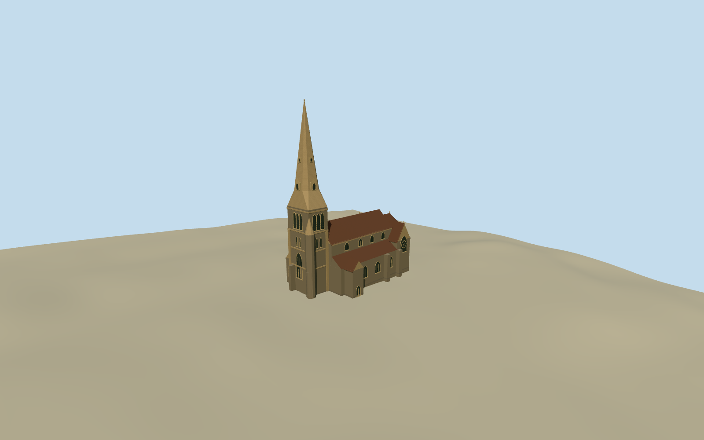

# All Saints' Church, Nottingham

Raleigh Street’s polychrome Gothic Revival church, with an octagonal broach spire, clerestoried nave and apsidal chancel.

Authoring state: **review-in-qa.json**. Current completion evidence is in [qa.json](qa.json) and the [completion ledger](../../../../qualla-structures/batches/qualla-004.PROGRESS.md).

- [All Saints' Church, Nottingham](https://qualla.com/all-saints-church-nottingham/)

The model represents the listed church. The independently listed school, vicarage, community centre, gates and railings remain outside its scope.

The rock-faced sandstone massing follows the mapped footprint. The nominal 53.34 metre spire follows the 175-foot parish and Victorian gazetteer accounts. A 1924 local source gives 154 feet, and the height has not been independently surveyed.

Approximate upper wall heights, isometric roof junctions, stone band spacing and tracery represent the documented exterior at medium fidelity.

Build: `node content/worldgen/source/places/gc/gcr/all_saints_church_nottingham/models/generate-all-saints-church-nottingham.mjs`. Add `--check` to verify exact regeneration. 7259 triangles; 4 materials; no embedded photographs.
