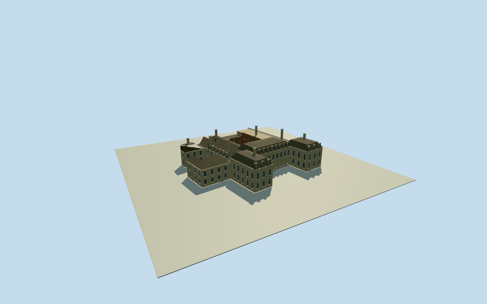

# Boughton House

Whole native23-control Boughton House with eight-control open court, north half-H stone range/three mansard roofs/physical dormers, nine real open loggia bays/upper sash windows, long west balustraded range, eastern and earlier brick courtyard ranges, stone stacks and intrinsic entry treads. Four exact public-domain CharlesLatham1909 photographs after Qualla-first31family search. Roof/court subdivisions/heights/hidden/current details bounded original estimates.

Authoring state: **review-in-qa.json**. Current completion evidence is in [qa.json](qa.json) and the [completion ledger](../../../../qualla-structures/batches/qualla-002.PROGRESS.md).

- [Boughton House](https://qualla.com/boughton-house/)

Actual whole BoughtonHouse stately-home multipolygon relation1412406,23-control outer wall ring98493797 and8-control native courtyard98493800. No estate parcel/building substitution. Roof subparts and other court subdivisions explicit photographic/listing-derived estimates.

Whole Boughton House physical stately-home relation1412406/Q4949432,23-control outer wall ring98493797 and8-control intrinsic courtyard98493800. Include north half-H French range with mansard-roofed pavilions/central arcaded loggia, long west balustraded range, eastern range and lower earlier courtyard ranges/gabled hall/stone stacks. Keep native courtyard open, distinguish derived roof/subrange layout and intrinsic entrances/steps from measured native wall controls. Exclude BoughtonPark/estate/parking, detached stable/service blocks, gates, gardens, furnishings and interiors.

Original independent field frozen before fixed original north-approach floor sample and all main heights/roof subranges. Native wall plan and photo/listing-derived original subrange/roof estimates remain distinct. Exact court/threshold/foundation contact unverified, preview/replacement false.

All23nativeouter and8nativecourt controls retained; court stays open. Native wall polygons do not measure roof subdivisions/hidden courtyards or heights. Mansard/range/hip joins/oculus approximations/window census/stone colors/current repairs are bounded original photographic/listing-text estimates; no survey, exact current fitout or interior reconstruction.

Only four exact1909CharlesLatham public-domain original book photographs adopted after publishedQualla31families first. Exact named creator1847-1912, dated library book/photographic attribution and explicit nativePD-old-70-1923 retained. No source photograph pixels/ivy/gardens/trees/detachedstables/gates/estateparcel or protected listing imagery embedded.

Original512m129field/fourrawtiles/frame frozen before fixed floor/mainsections/geometry. No field/floor fitting, flattening, replacement, reframing, reacquisition or raising. Exact threshold/courtyard/foundation contact unverified; preview/replacement false.

Build: `node content/worldgen/source/places/gc/gcr/boughton_house/models/generate-boughton-house.mjs`. Add `--check` to verify exact regeneration. 30239 triangles; 5 materials; no embedded photographs.
