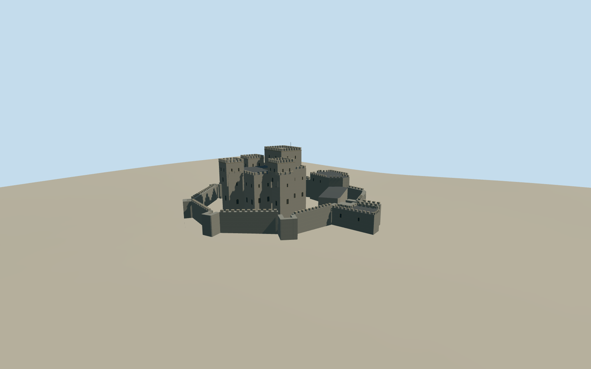

# Castle Rushen

Castle Rushen’s limestone keep with four crenellated towers, the curtain and separate harbour gate buildings in Castletown.

Authoring state: **review-in-qa.json**. Current completion evidence is in [qa.json](qa.json) and the [completion ledger](../../../../qualla-structures/batches/qualla-003.PROGRESS.md).

- [Castle Rushen](https://qualla.com/castle-rushen/)

The model represents the limestone keep, enclosed court, curtain wall and gate buildings seen in 2005. The modern visitor layout and interiors are outside the scope.

The highest tower uses the published 24 m height. Relative tower tiers, crenel counts, lower gate details and wall heights away from the harbour photo are estimates.

Build: `node content/worldgen/source/places/gc/gcs/castle_rushen/models/generate-castle-rushen.mjs`. Add `--check` to verify exact regeneration. 10129 triangles; 5 materials; no embedded photographs.
