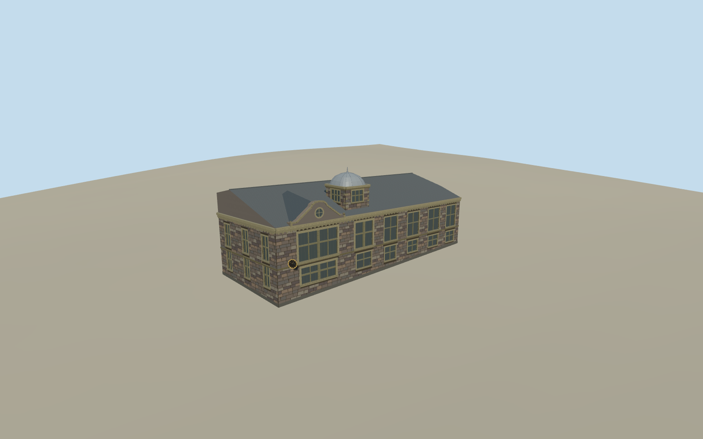

# Douglas City Hall

The Isle of Man’s Douglas City Hall with dark local rubble, pale Bath stone, stepped gable and oculus, projecting clock and metal-roofed square turret.

Authoring state: **review-in-qa.json**. Current completion evidence is in [qa.json](qa.json) and the [completion ledger](../../../../qualla-structures/batches/qualla-003.PROGRESS.md).

- [Douglas City Hall](https://qualla.com/douglas-city-hall-isle-of-man/)

The main gable, window group, plaque and projecting clock follow the 2013 views. The roof layout, windows and ornament outside the photo coverage and precise dimensions are approximate.

The 1900 description places the main entrance on John Street. Its bay, door detail and exact threshold are approximated using the local grade.

The DEM field is unchanged and supports approximate grade contact. The pre-2024 exterior represents the photographed date.

Build: `node content/worldgen/source/places/gc/gcs/douglas_city_hall/models/generate-douglas-city-hall.mjs`. Add `--check` to verify exact regeneration. 12761 triangles; 6 materials; no embedded photographs.
