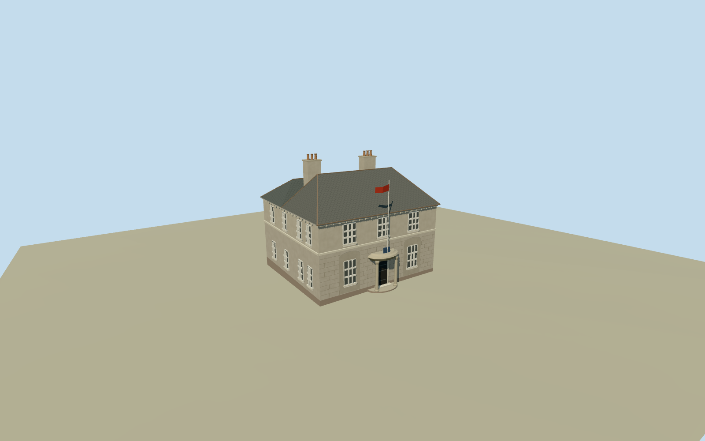

# Old House of Keys

Castletown’s Georgian Old House of Keys with a curved columned porch, three-bay sash frontage and twin slate roof ridges.

Authoring state: **review-in-qa.json**. Current completion evidence is in [qa.json](qa.json) and the [completion ledger](../../../../qualla-structures/batches/qualla-004.PROGRESS.md).

- [Old House of Keys](https://qualla.com/old-house-of-keys/)

Eave, ridge and chimney heights are estimated from the released exterior photograph. Smaller details on the rear elevation are approximated.

Build: `node content/worldgen/source/places/gc/gcs/old_house_of_keys/models/generate-old-house-of-keys.mjs`. Add `--check` to verify exact regeneration. 5409 triangles; 5 materials; no embedded photographs.
