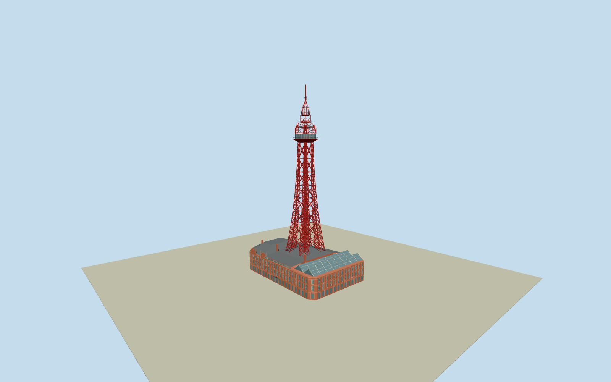

# Blackpool Tower

Complete intrinsic Tower Buildings native brick polygon and roofs, four tapering open lattice stanchions with constituent pillars/diagonal bracing, central twin lift framing, pale-framed polygonal glass main gallery, three open upper galleries/corner cupolas, ogee open crown and158mmast. Original mapped component positions/heights, Qualla-first public-domain night view plus inspected exact creator own-work CC0native exterior control recognizable geometry. Adjacent Art Deco clock/store building and modern shops, beach/pier/promenade, seasonal illumination art, interiors/people/branding excluded. Hidden sections and small facade/roof census approximate.

Authoring state: **review-in-qa.json**. Current completion evidence is in [qa.json](qa.json) and the [completion ledger](../../../../qualla-structures/batches/qualla-002.PROGRESS.md).

- [Blackpool Tower](https://qualla.com/blackpool-tower/)

Exact named intrinsic entertainment blockway99715340and Towerway213940301/Q880905with15original building-part outlines/heights/min-heights. Native min23m/height114m leg-part footprints control exposed taper positions; native112-115m lower gallery,115-124m main gallery,124-128m open stage,128-142/134-146m upper crown stages and158m mast control section relationships. Mapped solid/skeleton roof tags are geographic envelope approximations, rendered as actual open braced lattice from inspected photographs. Complete eight-vertex base block is actual building, not parcel; neighboring cream Art Deco store/modern shops not included. Independent untagged base facade/roof sections and exact member census are explicit estimates.

Qualla first: exact native MarkSJobling/Mjobling2006PD-userreleased night photograph controls silhouette only; clear supplemental MichaelDBeckwith2016native8688x5792own-workCC0photograph and pinned primary record control daytime structural form. Original SHA1matched; both viewed. Interior child/glassfloor/circus and unrelated/attribution/uncertain photographs excluded. No original photographic pixels or copied artwork/lettering embedded.

Exact original eight-vertex attached entertainment-block outline retained; native Towerway213940301/Q880905plus15component outlines/heights/min-heights control exposed legs/gallery/crown. Native solid/skillion tower tags are envelope approximations, interpreted as actual open braced steel. Published ground stanchion base100ft and30ftupper width support a bounded concealed root extension; native above-roof plan is not globally stretched.

Three unequal brick storeys, separate north ballroom roof, central raised circus roof/clerestory and twin south glazed roof-garden ranges follow original intrinsic building scope. Nominal16meaves/22mnorthroof and independent untagged facade/clerestory heights, exact window/pediment/roof-garden census and hidden current conservation are architectural estimates from inspected exterior and official text facts. No independently mapped neighboring Art Deco store/clock tower or modern shops included.

Four stanchions have constituent columns/open diagonal panels near, coarser representative bracing at district, and solid narrowed stanchion envelopes/sparse major crosses at skyline. Central closed twin lift framing remains narrow; surrounding inter-leg gaps stay open. Three upper gallery stages and original ogee rib/cupola interpretation remain open. Plate/member dimensions, connections, corner cupola census, concealed lift machinery and exact structural cross-sections are medium-fi estimates, not an engineering survey.

Opaque blue-grey glazing approximates closed observation/roof-garden panes. Applied window/terracotta ornaments have limited depth; ground door panels are closed rather than navigable interiors. No seasonal light artwork, flags/branding, interior circus/ballroom decoration, people or neighborhood landscape.

Independent220mrawTerrariumfield frozen before geometry at the fixed western entrance approach. Original tile bytes/grid/heightPNGremain unchanged, without flattening/fitting; composite coastal urban grade, beach/promenade edges and footings are approximate. No model ground platform or neighborhood terrain mesh. Flatstage is an inspection surface rather than geographic grade certification.

Build: `node packages/worldgen/scripts/generate-authored-places.mjs --ids=blackpool_tower`. Add `--check` to verify exact regeneration. 30043 triangles; 5 materials; no embedded photographs.
