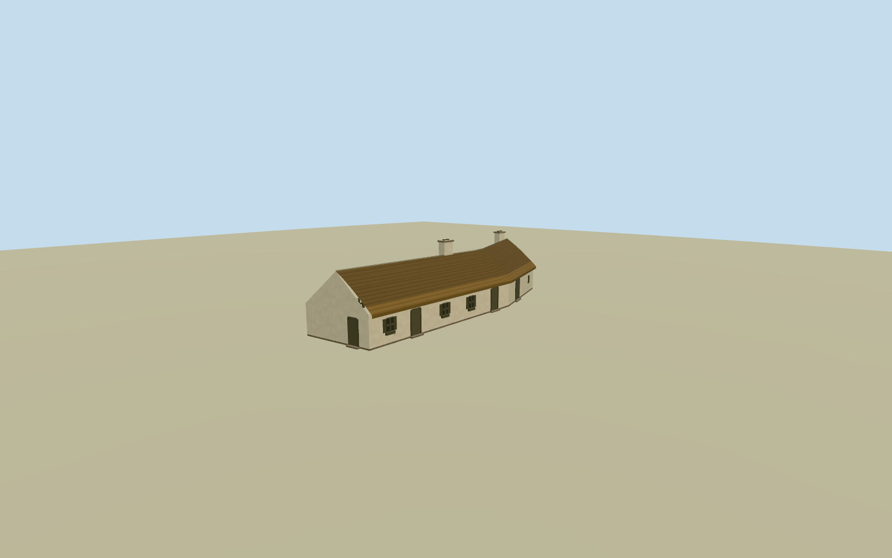

# Burns Cottage

The low whitewashed, thatched cottage at Alloway where Robert Burns was born, with the attached byre and barn.

Authoring state: **review-in-qa.json**. Current completion evidence is in [qa.json](qa.json) and the [completion ledger](../../../../qualla-structures/batches/qualla-004.PROGRESS.md).

- [Burns Cottage](https://qualla.com/burns-cottage/)

The preserved cottage including the attached agricultural bays. Freestanding wall, museum grounds and interiors lie outside the model scope.

Individual sill and stack heights are estimated from the photograph and heritage description.

Build: `node content/worldgen/source/places/gc/gcu/burns_cottage/models/generate-burns-cottage.mjs`. Add `--check` to verify exact regeneration. 730 triangles; 5 materials; no embedded photographs.
