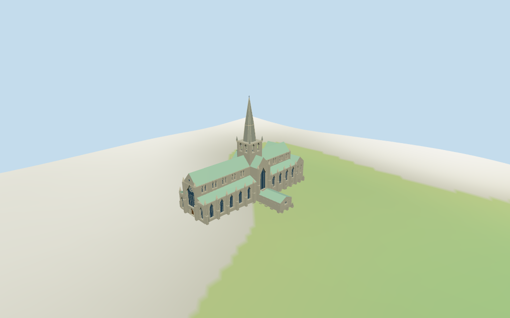

# Glasgow Cathedral

Individual Glasgow Cathedral: long Gothic nave/choir under pale copper roofs, lower lean-to aisles, crossing transepts, square open belfry and tall tiered faceted stone spire. Great west pointed glazing with circular rose-like tracery above a recessed wood portal, smaller flanking windows, gable oculus/pinnacles, repeated paired clerestory lancets, large aisle windows, east lower-church window band, buttresses and north/south subsidiary ranges. Shared ashlar/limestone/copper/wood. Standard-terrain foundations; no global flattening. Exact stained-glass artwork, stone sculpture/text, restoration scaffolding, graveyard/retaining terraces, trees, full interiors and certified walking excluded.

## Evidence and reconstruction

Published dimensions and reconstructed details are separated in spec.json. Primary references:

- [Reference](https://commons.wikimedia.org/wiki/File:Pogled_s_groblja_na_katedralu_u_Glasgowu_2024.jpg)
- [Reference](https://commons.wikimedia.org/wiki/File:Glasgow-cathedral-may-2007.jpg)
- [Reference](https://commons.wikimedia.org/wiki/File:01744_Glasgow_Cathedral_006.jpg)

Four existing shared256-square ashlar, limestone, copper and plain wood graphs. Darker stone spire reuses the ashlar graph; gray stone/pale trim and copper-green roof tints use linear colors and metric UVs. Glass/accents are flat PBR vertex colors. No embedded images, bespoke facade textures or baked soot/shadows. Temporary scaffold not modeled.

## Model and axes

13,132 triangles; 39,396 vertices; 6 material groups; 1,579,476 bytes. Native bounds: -49.773, -2.683, -28.641 to 49.178, 62.400, 27.455. Source hash: `sha256:b753ccf3e1f63e17ec5fa64cb3b2b3706d36ad74c6b05c61f4a6b3b1d11c7aee`.

{"x":"east-northeast toward eastern end","y":"up","z":"south-southeast"}

Standard DEM datum 36.618234m; display datum offset 0.4m, mapped perimeter terrain -2.33..3.05m. Foundations follow terrain. Western/northern entry thresholds use local DEM +0.22m; east lower-window bases use local terrain clearance. Coarse viewer terrain does not certify absolute altitude, crypt floor levels, retaining terraces, cemetery/step joins, paving, thresholds, cut/fill, interiors or walking. No global terrain flattening.

## Reproduce

Run `node packages/worldgen/scripts/generate-additional-landmarks.mjs --ids=glasgow_cathedral` (or add `--check`). The generator preserves manually edited masters by checking their baseline hashes. Import through the standard authored-model workflow with optimization disabled; then capture all QA cameras, including shared-surface views.

## Pending work

- Exact-QID OSMway102152591/Q1473348 matches current main35184474241423. Ten raw main/part plans retain all tags and min_height absences. Current high/transept roofs27m, aisle20m, chapter17m, sacristy21m, south range7m, low north entry4m, crossing square35m and octagonal spire min_height35m/height62m are approximate full envelopes, not stacked wall solids. The raw aisle20m tag is retained as an approximate envelope; rendered lean-to joins15.3m preserve exposed clerestory glazing instead of burying it. Estimated main eaves21m, aisle/chapter12.5m, sacristy15m, south4.7m, low entry3.2m and belfry28.5..35m subdivide those controls. Stone spire from35m tapers in stages to a short modeled62m finial. Retained facts provide no independent measured dimensions. Boolean joins round local coordinates to0.1mm for robust coincident-edge clipping; raw controls remain untouched. Joined part volumes regularize tiny raw buttress notches; detailed foundation retains mapped main envelope. Crypt fenestration, buttress rhythm and thresholds are picture/standard-DEM estimates.
- Standard DEM datum 36.618234m; display datum offset 0.4m, mapped perimeter terrain -2.33..3.05m. Foundations follow terrain. Western/northern entry thresholds use local DEM +0.22m; east lower-window bases use local terrain clearance. Coarse viewer terrain does not certify absolute altitude, crypt floor levels, retaining terraces, cemetery/step joins, paving, thresholds, cut/fill, interiors or walking. No global terrain flattening.
- Medium-fi exterior from three useful pictures and standard PMTiles/DEM. Current heights are approximate map envelopes; roof slopes, window/rose geometry, buttress rhythm, crypt windows/floor levels and thresholds are estimates. Exact stained-glass art, carvings/text, scaffolding, graveyard/retaining terraces, landscaping, full interiors and certified walking excluded. Physical device timing pending.
- Skyline preserves the long roofs, aisles/transepts, northern ranges and square/octagonal stone spire. District adds shared textures, flat glazing/doors, gable oculus and open belfry. Street adds recesses, paired lancets, stepped buttresses/pinnacles, portal bands, great-window circular tracery and spire ribs; closeup/master refine facets/petals. Synthetic context neighbors are not mapped Glasgow buildings.

This bundle follows the medium-fi standard. Medium-fi appearance and geographic fit are reviewed separately. Hash-bound visual acceptance is recorded separately after capture inspection.

## Additional geographic data

©OpenStreetMap contributors; Protomaps; Mapzen/USGS terrain tiles.
