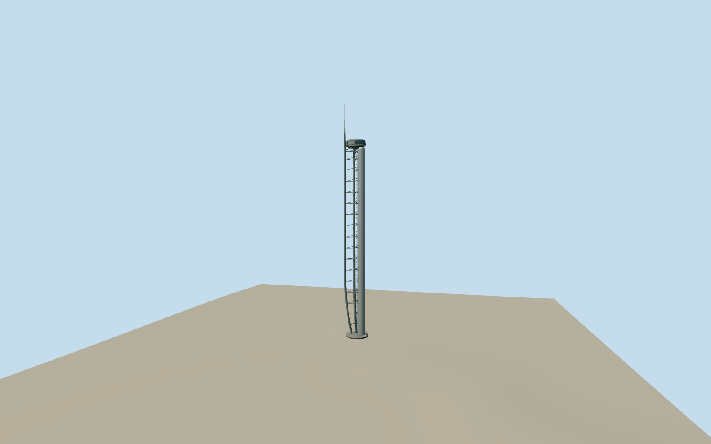

# Glasgow Tower

Glasgow Tower at Pacific Quay with triangular aerofoil supports, thin braces, glazed viewing pod and an aerial 127 metres above ground.

Authoring state: **review-in-qa.json**. Current completion evidence is in [qa.json](qa.json) and the [completion ledger](../../../../qualla-structures/batches/qualla-003.PROGRESS.md).

- [Glasgow Tower](https://qualla.com/glasgow-tower/)

Static 2023 exterior preview with an estimated turntable angle. The tower can rotate and its exact bearing on October 1 is unknown.

The main heights and circular base are measured controls. The shaft sections, opposite-side details, support sections and visible base details are reconstructed estimates.

The original Pacific Quay elevation field is preserved. Exposed ground contact and the turntable collar use approximate paving grade.

Build: `node content/worldgen/source/places/gc/gcu/glasgow_tower/models/generate-glasgow-tower.mjs`. Add `--check` to verify exact regeneration. 7112 triangles; 5 materials; no embedded photographs.
