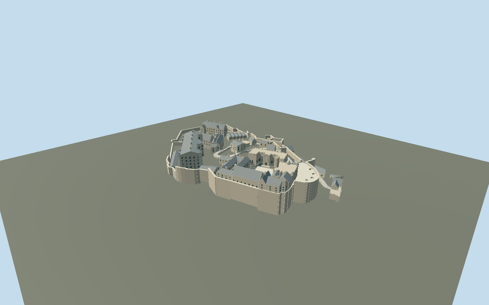

# Edinburgh Castle

Edinburgh Castle with stepped wards, open Crown Square and Hospital Square, Royal Palace and octagonal clock turret, Great Hall, Queen Anne range, Scottish National War Memorial, St Margaret chapel, New Barracks, Governors House, Half Moon and Argyle batteries, and open gate passages.

## Evidence and reconstruction

Published dimensions and reconstructed details are separated in spec.json. Primary references:

- [Reference](https://www.openstreetmap.org/way/4301292)
- [Reference](https://www.edinburghcastle.scot/media/fpanlfr2/orientation-map.pdf)
- [Reference](https://www.edinburghcastle.scot/see-and-do/highlights/the-royal-palace/)
- [Reference](https://www.edinburghcastle.scot/see-and-do/highlights/half-moon-battery/)
- [Reference](https://commons.wikimedia.org/wiki/File:Edinburgh_Castle_plan_coloured.png)
- [Reference](https://commons.wikimedia.org/wiki/File:Edinburgh_Castle_from_the_south_east.JPG)
- [Reference](https://commons.wikimedia.org/wiki/File:Façade_of_the_Scottish_National_War_Memorial,_Edinburgh_Castle,_Scotland,_UK.jpg)

No third-party geometry, photograph or bitmap texture is embedded. Shared surface graphs come from the central library; vertex tints carry model colors. Glazing uses PBR materials; transparent surfaces are declared per model.

## Model and axes

47,006 triangles; 94,058 vertices; 6 material groups; 3,953,896 bytes. Native bounds: -138.541, -22.131, -75.716 to 125.849, 52.000, 75.800. Source hash: `sha256:46932b0fcfc354df497b50aa6c4a1ea9a70f0cab69422daf307f9b61829baa14`.

{"up":"+Y","longitudinal":"+X toward the eastern entrance/esplanade","front":"+Z toward the southern palace and barracks exterior","origin":"Exact-Q212065 precinct frame;Y0 relative east-gate reference[106.54,-25.61]."}

Fresh exact-Q212065 precinct way4301292 and116individual mapped parts match original coordinates within1.7mm. Native+X76.35deg follows the east gate/esplanade;+Z166.35deg faces southern palace/barracks. Whole-precinct replacement is disabled. Retained Scottish Public Sector LiDAR Phase5OGL3 bare-earth0.5mF32 crop and OSTN15 grid conversion establish a3m native relative fixture. Y0 references the east gate[106.54,-25.61],source height111.547m,used relatively; no absolute vertical datum is asserted. CrownSquare floor20m,chapel21.8m,NewBarracks11m,HospitalSquare3.8m and Portcullis7m are photographic working elevations adjusted to this evidence,not a floor survey. Separate foundations extend beneath slopes; the model supplies defensive masonry but no second CastleRock hill. Host must supply fine terrain.

## Reproduce

Run `node packages/worldgen/scripts/generate-signature-towers.mjs --ids=edinburgh_castle` (or add `--check`). The generator preserves manually edited masters by checking their baseline hashes. Import through the standard authored-model workflow with optimization disabled; then capture all QA cameras, including shared-surface views.

## Pending work

- Original detailed master21794276bytes/259930triangles remains exactly reproducible atsha256:4cd274cfb172ebeddbbb803c2f7f3cd6aa3140f3c27f8823e8bda61562641388 from edinburgh-castle-model.mjs#edinburghStudy.build. Separate reviewed source corrects relative floors and foundation contact and retains open passages at every detail level.
- Fresh exact-Q212065 precinct way4301292 and116individual mapped parts match original coordinates within1.7mm. Native+X76.35deg follows the east gate/esplanade;+Z166.35deg faces southern palace/barracks. Whole-precinct replacement is disabled. Retained Scottish Public Sector LiDAR Phase5OGL3 bare-earth0.5mF32 crop and OSTN15 grid conversion establish a3m native relative fixture. Y0 references the east gate[106.54,-25.61],source height111.547m,used relatively; no absolute vertical datum is asserted. CrownSquare floor20m,chapel21.8m,NewBarracks11m,HospitalSquare3.8m and Portcullis7m are photographic working elevations adjusted to this evidence,not a floor survey. Separate foundations extend beneath slopes; the model supplies defensive masonry but no second CastleRock hill. Host must supply fine terrain.
- Six shared weathered limestone,sandstone,slate,timber,painted-metal and ceramic graphs plus opaque PBR glass. Carved trim reuses sandstone grain. Skyline bakes common graph linear means into one draw. No copied photography or embedded bitmaps.
- Exterior medium-fi reconstruction. Bay counts,eaves,working floors,roof junctions and statue niches are approximations. No exact carvings,inscriptions,memorial sculptures or interiors. Bare-earth interpolation beneath roofs does not establish occupied floor heights.
- Phase5metadata describes2020–2021 capture but exact tile vintage and vertical datum are not asserted. The restricted HES Scottish Ten data was excluded. Retained0.5mpublic crop is source evidence;3mfixture is a practical contact check,not an exhaustive survey. Physical laptop/phone dense-view timings remain pending.
- CrownSquare/forecourt/HalfMoonBattery paving is reconstructed at20.2m; mapped drawbridge and winding road have working gate floors0/7m and terrain-derived slopes. A reversible mask covers only their connected paved surfaces. Road width,gradients and bridging are exterior approximations,not a navigation survey. The memorial-palace connecting arch follows the owner courtyard photo.

This bundle follows the medium-fi standard. Medium-fi appearance and geographic fit are reviewed separately. Hash-bound visual acceptance is recorded separately after capture inspection.

## Additional geographic data

Map geometry © OpenStreetMap contributors, ODbL-1.0. Reference photos linked only; no copied image textures or external meshes.
