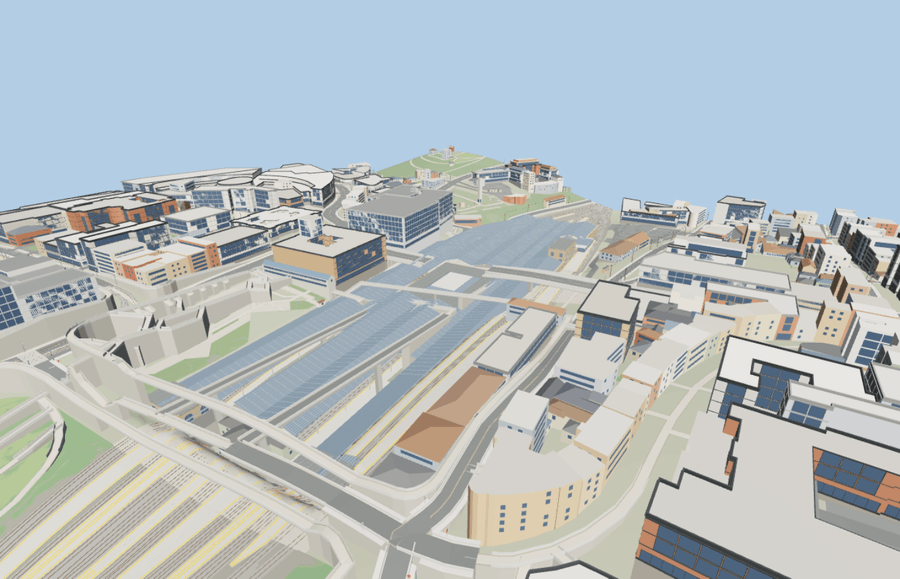

# Edinburgh Waverley Railway Station

Five rows of separate pitched shed roofs, the booking hall opening, both western pavilions and the glazed Market Street entrance remain distinct. The lower concourse and track corridors sit beneath the sheds.

The common 52.70 m reference remains at the eastern end of the tracks. Local grades clear the lower rail floor and expose the west pavilion and Market Street entrances. The fixture retains the bridge approach terrain, all 541 independent buildings and all 687 road and rail records. The eight grouped station building records are replaced by the original asset.

Failed loading preserves the native layers. Eviction restores the ground and releases model geometry.

| Detail level | Triangles | Download bytes | Draws |
| --- | ---: | ---: | ---: |
| skyline | 992 | 90,708 | 1 |
| district | 3,355 | 301,872 | 7 |
| street | 9,828 | 850,260 | 7 |
| closeup | 33,636 | 2,855,160 | 7 |

Skyline and district total 392,580 bytes. Six GLBs pass Khronos validation and contain zero embedded images. Six shared material graphs bind in the viewer. The review covers 76 renders and 150 geographic samples.

The model covers the passenger exterior, enclosed ranges, canopies and visible stair connections. Entrance levels, underground spaces and hidden roof details remain approximate.

North Bridge and Waverley Bridge use the host map and procedural surfaces. Their exact deck elevations and continuous pedestrian routing are outside this model review.

Rebuild with node packages/worldgen/scripts/generate-edinburgh-waverley-railway-station.mjs. Add --check to verify exact bytes.

[Mapped site frame](map-frame.json) · [Terrain fit](site-fit.json) · [QA evidence](qa.json)
