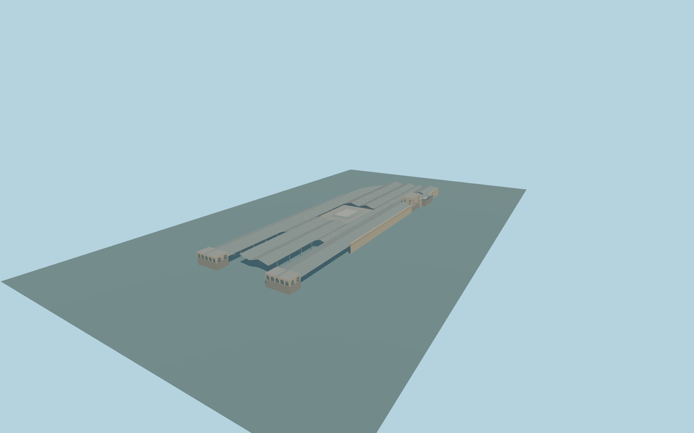

# Edinburgh Waverley railway station

Complete permanent Edinburgh Waverley station exterior: full mapped pitched/glazed five-row roof field with central opening,western classical entrance pavilions and descending links,all six internal stone passenger/service ranges,central booking-hall rooflight,long arched Market Street stone frontage,upper street office,curved glass entrance pavilion and two descending glazed stair roofs. Preserve independent Waverley Market,Balmoral/other hotels,bridges,roads,rails andplatform space. No trains,buses,brands,sculptures or navigable interiors.

Rebuild: `node packages/worldgen/scripts/generate-edinburgh-waverley-railway-station.mjs`;append `--check` for exact source bytes. Select import/LOD/placement with `--ids=edinburgh_waverley_railway_station`. Detailed source and four browser tiers are separate ignored GLB outputs.

Complete permanent Edinburgh Waverley station exterior: full mapped pitched/glazed five-row roof field with central opening,western classical entrance pavilions and descending links,all six internal stone passenger/service ranges,central booking-hall rooflight,long arched Market Street stone frontage,upper street office,curved glass entrance pavilion and two descending glazed stair roofs. Preserve independent Waverley Market,Balmoral/other hotels,bridges,roads,rails andplatform space. No trains,buses,brands,sculptures or navigable interiors.

Native8m booking/eastern ranges and5m narrow range remain map facts. Source lower floor+.65m,upper street entrances+7.5m,main pitched-roof eaves9.5m/crowns11.5–13.5m,main booking hall8m/rooflight10.2m and Market Street office20m. Unknown small-range roofs use5.5m/6m. The source deliberately models upper-street to lower-station connections rather than placing every floor at one height. Exact rail floor and historic threshold elevations remain approximate. One unchanged standard host sample outside the eastern station roof,local[315,10], 52.695071999999996m supplies one common datum. Source foundations/support feet-6m,lower occupied floor+.65m andupper entry floors+7.5m. No per-part host offsets or artificial surrounding plaza. The prepared urban field rises over the lower station and must be reviewed explicitly;the rounded63m grid-center sample isnot a lower-platform datum.

Two adequate ordinary exterior pictures inspected. Main roof arrangement,stone frontage and multilevel Market Street entrance are observed. Exact hidden opening inventory,rooflight form,western descending links,rib counts,threshold levels and detailed stair construction are coherent original medium-fi approximations. No bespoke terrain or archival research. Retained station POI androof/passenger polygons are approximate physical matches,not exact Wikidata-tagged individual buildings. Mainroof overplatforms staysopen below. Closedancillary floors andupperentry buildings aredistinct fromopen platforms andwesternstairlinks. Modern glazed stairwells haveactual stepped closed bases;openwesternlinks do not maskground. Mapped outer-roof duplicates803/2229 are replaced alongside1560/2648;source roofpanels arecutback aroundthe modernentry andstairwells ratherthan occluding them. Exacthistoric railfloor,bridgeclearances andstreet/threshold levels remainunverified. Preserve allnative roads,rails andindependent bridges. Physical-device timing andnumericalLODerrors remainunmeasured.

Six existing shared256px sandstone,granite,membrane,painted-metal,window-grid andstorefront graphs;seven semanticgroups maximum because paintedmetal hasroof andstructural slots. MetricUVs,linearcolors andno private/embeddedimages. Skyline retainsallfivepitchedroofrows,thecentralopening,six internalranges,westernpavilions andboth MarketStreetentryelements,withtrue slopingstairlinks. Districtaddscoarseclosedglazing androofstructure. Streetaddsactualrecesses,blindstonearches androofribs. Close-upaddsfullwindowinventory,frames,stairtreads andfiner curvedentranceroof. Master separatelyrefinescurves androofribspacing. Straightroofslopes are notneedlessly subdivided.

Original geometry:repository license. Map:© OpenStreetMap contributors,ODbL-1.0;Protomaps. Standard terrain:terrain-grid.json. Ordinary pictures stay local and are not redistributed or used as textures. Current acceptance:qa.json.
