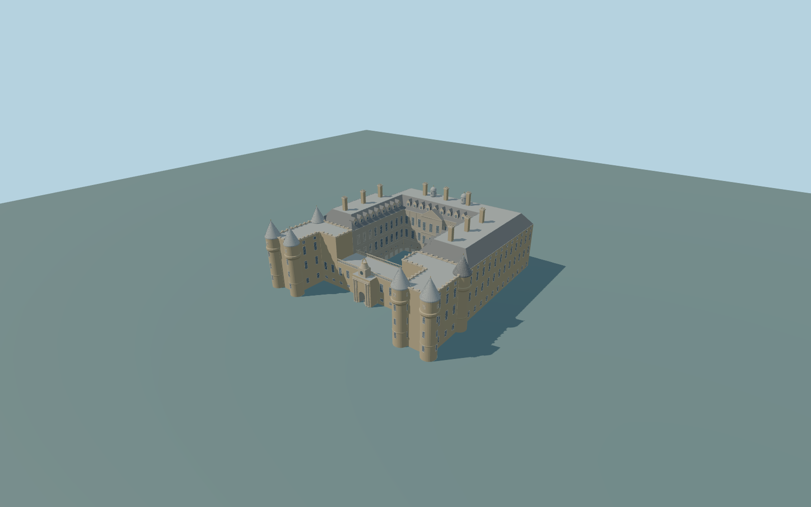

# Holyrood Palace

Complete principal Palace of Holyroodhouse quadrangle exterior,west paired tower blocks/round corner turrets,low entrance link/clock-crown gate,three higher ranges,actual ground-floor arcades/gallery walks/front through-passage,all pitched slate/low sheet-metal roof zones,dormers/chimneys/two rear cupolas and rear stair projection. Independent roofless abbey,fountain,wider gardens/service/guard buildings,flags/furniture and optical interiors excluded.

Rebuild: `node packages/worldgen/scripts/generate-holyrood-palace.mjs`;append `--check` for exact source bytes. Select import/LOD/placement with `--ids=holyrood_palace`. Detailed source and four browser tiers are separate ignored GLB outputs.

Complete principal Palace of Holyroodhouse quadrangle exterior,west paired tower blocks/round corner turrets,low entrance link/clock-crown gate,three higher ranges,actual ground-floor arcades/gallery walks/front through-passage,all pitched slate/low sheet-metal roof zones,dormers/chimneys/two rear cupolas and rear stair projection. Independent roofless abbey,fountain,wider gardens/service/guard buildings,flags/furniture and optical interiors excluded.

Use actual individual range/L-shaped tower-block outlines and six mapped round turrets;never solidify the parent court. Three taller ranges carry a continuous U-shaped truncated slate hip with a shared-metal upper deck. Open arcades have real curved soffits,deep gallery floors/closed windowed back walls;central west passage stays open through the low entrance range. Separate roofless abbey is retained.

Native range18m/turret21m/block15m/link9m tags are generalized envelopes. Original photo-proportional main eave18.6m/roof23m,tower wall18.7m/cone24.4m,low entrance9.8m,clock/crown~16m,chimneys~28m/two cupolas~27m above41m approximate datum are not surveyed. Lower exterior foundations and arcade/gallery bases sample the unchanged field;gallery bases follow field+.12m beneath common spring3.1m/top5.9m. No raised whole-court slab or terrain flattening. Exact historical levels/accessibility approximate.

Original interpretation from four ordinary pictures and standard PMTiles/global terrain. Fine relief/crown/clock/window/dormer/chimney inventories,roof joints and historic threshold/accessibility grades approximate. No downloaded mesh,bespoke survey,PDF/archive study or copied sculpted art/lettering. Closed panes/doors exclude optical interiors;the court,arcades and entrance passage remain actual open exterior geometry. Independent abbey/fountain/gardens/guard buildings excluded. Physical device timings unmeasured.

Six existing256px sandstone,limestone,slate,painted-metal,window-grid andpainted-wood graphs;metric UVs/linear colors. Six mapped turret circles bound original cylinder/corbel/cone silhouettes. Rear stair projection is upper-only above actual open ground arcades. Source keeps denser arch soffits,turret/corbel/cone profiles,window grids,dormer frames,balusters,chimney vents and roof trim. Far preserves open court,three aggregated rectangular gallery bays per side,through gate,towers/six cones,two roof cupolas and two chimney silhouettes;subpixel windows/dormers/ornament omitted. District has seven actual curved arches per side/coarse profiles and few dormers,street nine arches/flat window frames,close-up dense arches/frames/profiles. Fine inventories are original approximations;no copied text or sculpted art. Error estimates3/1.5/.7/.25m are not measured mesh distances. Physical laptop/phone/dense-city timing unmeasured.

Original geometry:repository license. Map:© OpenStreetMap contributors,ODbL-1.0;Protomaps. Standard terrain:terrain-grid.json. Ordinary pictures stay local and are not redistributed or used as textures. Current acceptance:qa.json.
