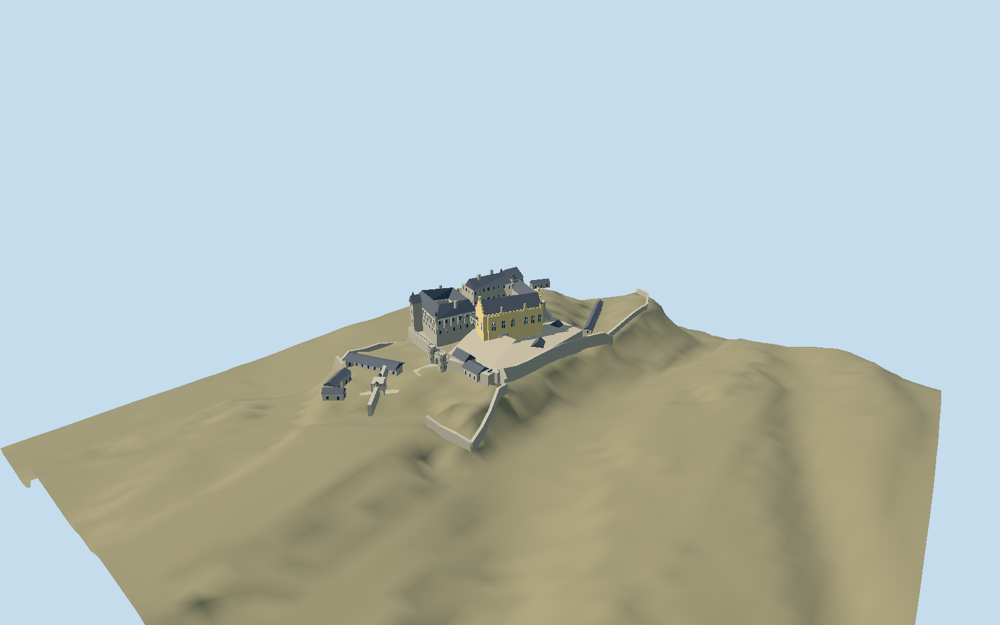

# Stirling Castle

Present-day fortified compound with ochre Great Hall, open Lion’s Den palace court, Chapel Royal, King’s Old Building, low twin-drum Forework and walled Nether Bailey.

## Evidence and reconstruction

Published dimensions and reconstructed details are separated in spec.json. Primary references:

- [Reference](https://portal.historicenvironment.scot/designation/SM90291)
- [Reference](https://www.historicenvironment.scot/publications/all/publication/?publicationId=420047e5-b241-4318-9127-a5f400f193f9)
- [Reference](https://app-hes-pubs-prod-neu-01.azurewebsites.net/api/file/1a36b0f6-f3e3-4374-b1d2-a603009ca16a)
- [Reference](https://www.openstreetmap.org/way/100542995)
- [Reference](https://www.openstreetmap.org/relation/1083531)

No third-party geometry, photograph or bitmap texture is embedded. Shared surface graphs come from the central library; vertex tints carry model colors. Glazing uses PBR materials; transparent surfaces are declared per model.

## Model and axes

8,024 triangles; 18,324 vertices; 4 material groups; 758,756 bytes. Native bounds: -65.127, -33.414, -159.162 to 65.702, 30.056, 139.152. Source hash: `sha256:0e529b4538682631f17a0cf326aea9e9935fe087d2409c6bf94ef75a58d92eaf`.

{"up":"+Y","longitudinal":"+Z southeast toward the entrance","front":"+Z southeast","origin":"Signed mapped compound; Y0 decoded LiDAR102.05 m working datum."}

Fresh castle boundary way100542995 v12/Q756268 and26 mapped components retain source plan to within0.000676 m rounded vertex difference. Anchor[-3.948153826,56.124036337], heading0.7346639643808965: +X northeast47.906855 degrees, +Z southeast137.906855 degrees toward New Port/Forework. This is a campus boundary, not a building-replacement footprint. Great Hall northeast, palace southwest and Nether Bailey northwest sign the frame. New Port center[-3.68025,112.9895] and front axis derive from way68955248; front entrance node7003329479 confirms the mapped outer wall plane (front bearing about188.15 degrees, south-southwest). Source orientation0.73 was corrected independently to atan2(-7.506,6.238). Retained public Scottish Phase4 2017–2019 EPSG27700 DTM has native0.5 m cells and129²4 m diagnostic samples, working datum102.05 m. OSTN15 reports1 m horizontal accuracy; native cell size is not survey accuracy and vertical transformation/vintage at the individual cells remain unverified. Inner close4.0559 m, architecture shift-3.9441 m, forework floor-5.9490 m, New Port-9.7861 m and north gate-7.9155 m are reconstructed fitting levels. Bounded buried masonry terraces and entrance aprons meet retained ground. The volcanic cliff and open lower-bailey ground remain host terrain. No ground cutout.

## Reproduce

Run `node packages/worldgen/scripts/generate-signature-towers.mjs --ids=N0262` (or add `--check`). The generator preserves manually edited masters by checking their baseline hashes. Import through the standard authored-model workflow with optimization disabled; then capture all QA cameras, including shared-surface views.

## Pending work

- Original8327-triangle/768644-byte master reproduces at sha256:ccc7e8dc71d97488c56879f42e20bd27356fd2685bca5de765a5f169fd20f938 from unchanged stirling-castle-model.mjs#buildStirlingRuntime and unchanged map-frame.geometry/parts.
- Fresh castle boundary way100542995 v12/Q756268 and26 mapped components retain source plan to within0.000676 m rounded vertex difference. Anchor[-3.948153826,56.124036337], heading0.7346639643808965: +X northeast47.906855 degrees, +Z southeast137.906855 degrees toward New Port/Forework. This is a campus boundary, not a building-replacement footprint. Great Hall northeast, palace southwest and Nether Bailey northwest sign the frame. New Port center[-3.68025,112.9895] and front axis derive from way68955248; front entrance node7003329479 confirms the mapped outer wall plane (front bearing about188.15 degrees, south-southwest). Source orientation0.73 was corrected independently to atan2(-7.506,6.238). Retained public Scottish Phase4 2017–2019 EPSG27700 DTM has native0.5 m cells and129²4 m diagnostic samples, working datum102.05 m. OSTN15 reports1 m horizontal accuracy; native cell size is not survey accuracy and vertical transformation/vintage at the individual cells remain unverified. Inner close4.0559 m, architecture shift-3.9441 m, forework floor-5.9490 m, New Port-9.7861 m and north gate-7.9155 m are reconstructed fitting levels. Bounded buried masonry terraces and entrance aprons meet retained ground. The volcanic cliff and open lower-bailey ground remain host terrain. No ground cutout.
- Four-meter local diagnostic grid resamples 0.5m DTM; native cell size is not a guarantee of positional/survey accuracy. OSTN15 horizontal operation reports1m accuracy; vertical datum and individual-cell acquisition date unverified.
- Nodata beneath removed buildings and narrow gaps is bounded nearest-valid interpolation for diagnostics; raw cropped Float32 evidence retains all nodata. No roof heights are inferred from nodata.
- Terrace levels and exterior heights remain authored approximations; retained ground supplies core foundation/entrance and lower-bailey contact. Volcanic cliff is host terrain, not a copied surveyed castle mesh.
- Rejected first Terrarium datum79.6058m and coarse Copernicus DSM106.9468m; the latter includes buildings/vegetation and cannot be used directly as ground.
- Accepted reconstructed present-day exterior ensemble: ochre Hall with crow steps, palace/Lion’s Den, Chapel, King’s Old Building, truncated Forework with three actual open passages, low New Port, north gate and mapped ancillary blocks. Independent derivative corrects New Port bearing and separates the higher core from lower entrances/bailey. Hall bridge has reconstructed pointed underside and three opaque pointed window reserves. No interior or navigable-route claim.
- Main eaves/ridges, sculptural niches, window rhythm, drum spacing, north gate profile, wall tops and ancillary roofs remain photographic approximations. The historical north dogleg is not reconstructed. Native passage and court levels are unverified; graded aprons are fitting aids, not surveyed accessible routes. Queen Anne’s garden planting, esplanade, statues, off-site gardens and volcanic-cliff mesh are omitted. Exact2026 daily conditions and temporary furniture are unverified.
- Three common graphs supply sandstone, lime plaster and slate; local opaque PBR supplies glazing and unused foliage palette. Skyline bakes actual linear common means. No per-model photographic textures or embedded images. Physical laptop/phone timings remain pending.

This bundle follows the medium-fi standard. Medium-fi appearance and geographic fit are reviewed separately. Hash-bound visual acceptance is recorded separately after capture inspection.

## Additional geographic data

Footprints © OpenStreetMap contributors, ODbL-1.0. HES guide images are linked visual evidence only; no third-party images or meshes are redistributed.
