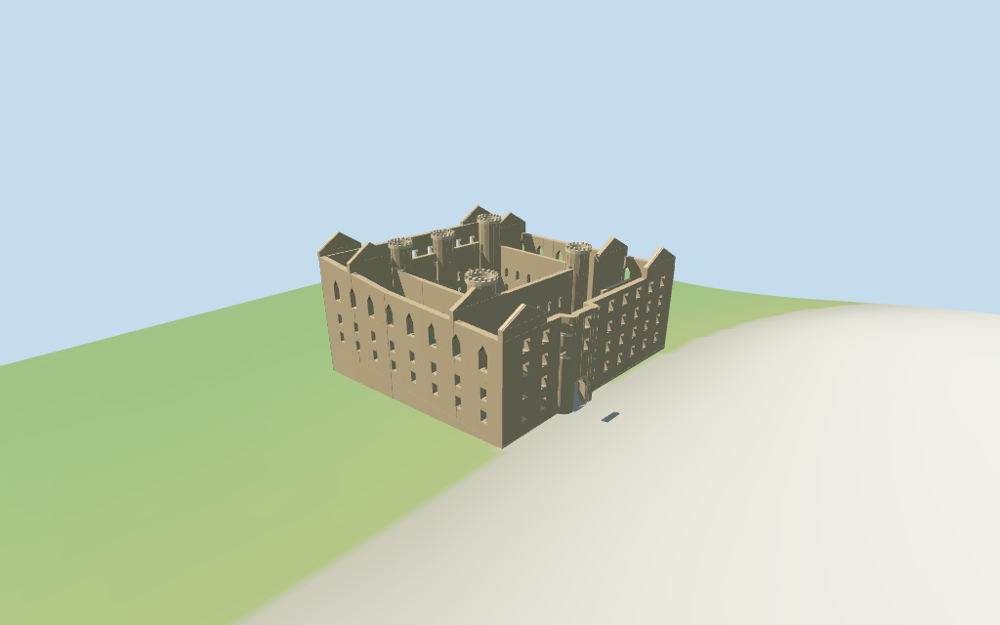

# Linlithgow Palace

Individual roofless palace: mapped square courtyard and fountain, separate outer/court walls with real rectangular/Gothic openings, five unequal hollow stair towers, four surviving corner gable pairs, mapped south/east entrance tunnels and selected open room partitions/wall walks. No restored roof slab or adjacent church.

## Evidence and reconstruction

Published dimensions and reconstructed details are separated in spec.json. Primary references:

- [Reference](https://crosswoodhill.co.uk/west_lothian.php)
- [Reference](https://www.castles-palaces.com/castles/scotland/linlithgow-palace)

Two existing256-square shared graphs provide sandstone and weathered limestone with linear tints/metric UVs; small fountain water uses a vertex-colored palette. No unique bitmap, photographed masonry or embedded image.

## Model and axes

17,957 triangles; 53,871 vertices; 3 material groups; 2,157,212 bytes. Native bounds: -28.300, -3.438, -28.000 to 35.000, 29.150, 26.171. Source hash: `sha256:e692a94706f1b049b7b13ffdd9415d8c4f8163dc503abaf96cbce44c675546a8`.

{"x":"south toward entrance","y":"up","z":"west"}

Two inspected courtyard/exterior photographs and standard PMTiles/DEM guide the roofless palace. Main envelope and courtyard retain the exact-QID relation; all heights and damaged details are exterior estimates. Church, town, park and separate eastern building remain host content. © OpenStreetMap contributors, ODbL-1.0.

## Reproduce

Run `node packages/worldgen/scripts/generate-additional-landmarks.mjs --ids=N0322` (or add `--check`). The generator preserves manually edited masters by checking their baseline hashes. Import through the standard authored-model workflow with optimization disabled; then capture all QA cameras, including shared-surface views.

## Pending work

- Main registered palace and courtyard retain the exact mapped identity; nine current palace/part polygons, fountain and tunnel provide approximate fit. Component heights are untagged, so all elevations, damage and opening profiles are picture-led estimates.
- Coarse standard DEM supplies a working51.3701m anchor datum. Raised courtyard3.9m, foundations, approach ramp, wall walks and terrain joins are approximate; no bare-earth survey, terrain carving or certified walking collision.
- Roofless ranges and hollow stair wells remain open; selected partitions and gables do not claim complete historical room/stair plans. Fountain tiers and door decorations are simplified geometric interpretations, not exact heraldry or sculpture.
- Adjacent church, separate eastern mapped building, park, town, crowds, visitor fixtures and complete interiors are outside the palace asset and remain host content.
- Physical laptop and phone frame-rate measurements remain pending.

This bundle follows the medium-fi standard. Medium-fi appearance and geographic fit are reviewed separately. Hash-bound visual acceptance is recorded separately after capture inspection.

## Additional geographic data

© OpenStreetMap contributors; Protomaps; Mapzen/USGS terrain tiles.
