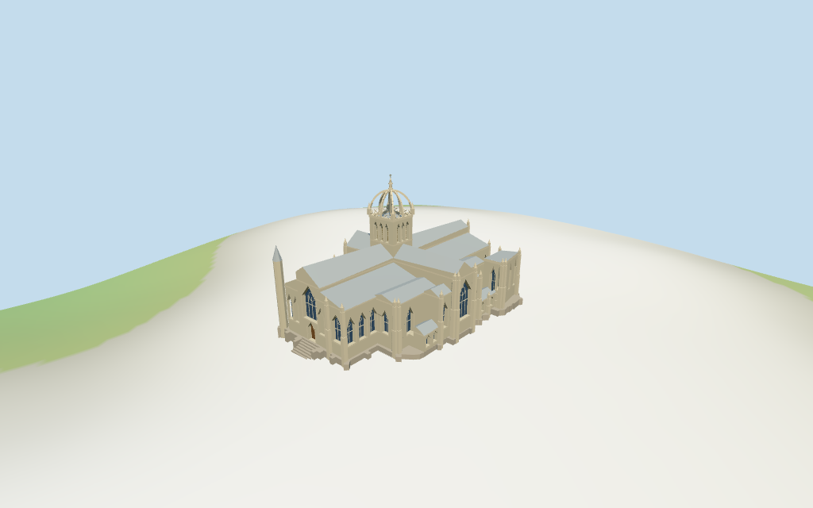

# st_giles_cathedral — St Giles' Cathedral review

Reviewed 2026-10-15 against current source/runtime bytes. Accepted for this medium-fi exterior and approximate geographic/terrain scope.

## Built result

Inspected all 11 current portable/source-terrain frames. St Giles has an open eight-rib stone crown with central shaft, four base pinnacles and tiered finial; its square tower has three narrow pointed louver fields per face. Broad lead-gray nave/choir, crossing, aisles and stepped side ranges retain the mapped massing. The west has a large pointed window above the wood entry, flanking pointed windows/blind niches, sparse tracery, buttress piers and northwest turret/cone. Three-window eastern choir and lower polygon-ended southeast Thistle Chapel remain distinct. Corrected the first estimated tower width/height against thirteen discovered map parts; connected tower/turret shafts down to their supporting mass, narrowed side-front niches, moved buttresses away from windows, cut overlapping walls and cleared roof-edge/cornice pieces across the upper east and west windows. The crown remains genuinely open; louver fields and doors/glass are closed. Exact carved figures, finial weathercock sculpture and stained-glass pictures are omitted.

Medium-fi exterior from four inspected aerial/front/east/crown pictures and standard viewer PMTiles/DEM only. Raw 6/14/16/20/39m heights control the respective masses. Wall/eave divisions, crown curves and shaft/pinnacles, window/tracery/louver rhythm, buttresses, corner turret, chapel/parapet details and stairs are picture estimates. Main body rings omit small map buttress notches within about 1.4m; the raw foundation cap retains the mapped envelope. Separate town buildings, the front monument, exact sculpture/lettering/stained-glass art, full interiors and certified walking are excluded. Physical laptop/phone timings and exact terrain thresholds remain pending.

## Shared materials and placement

Inspected all 11 current shared-material/geographic frames. Five existing 256-square coursed sandstone, raw sandstone, standing-seam metal, granite and plain wood graphs serve seven material groups. Warm gray-tan walls, pale trim, silver-gray lead-like roofs, stone foundations/steps and brown wood use linear tints and metric UVs. Glazing is flat blue-gray; louver backing and restrained finial metal use flat PBR color. No embedded images or bespoke facade textures, baked weathering, soot or shadows. Every graph reads once. Unload disposes geometry, leaves zero live model geometries and restores ground. Flat placement views establish signed plan alignment; source terrain views show approximate sloped contact. Ground colors are diagnostic.

Retained exact-QID way 42407060/Q1547466 matches current PMTiles main feature 35184414495892. Thirteen current building parts retain their unscaled outlines and heights: tower 39m, nave/crossing 20m, broad aisle 16m, side ranges/Thistle Chapel 14m and low projections 6m. Aisle plans reproduce subtraction of the higher nave/crossing from the broad 16m part. All recorded part transforms, raw tags and standard DEM match. Anchor [-3.190858255,55.949465243], heading 0.110403903006rad; west entrance, east choir and southeast chapel sign the retained axis. All 108 actual viewer footprint checks cover the main envelope and thirteen parts while preserving three unrelated neighbors and the western plaza across six outputs. Standard DEM datum 94.402203m, estimated floor 1.16m and perimeter terrain -1.91..0.91m give coarse contact. Foundations/turret/piers follow terrain; short west steps are an estimated transition. Exact street/door thresholds, cut/fill, absolute altitude and certified walking remain unverified. No road replacement.

Inspected all 27 current Earth-lighting frames: Economy/High, noon/late, three distances, silhouette, six detail crops, four matched whole-model LODs and four transitions. Skyline retains the eight open crown ribs/finial, central tower, broad stepped roof silhouette, northwest turret and inclined entrance at 901 triangles. District adds shared textures, flat Gothic windows/louvers/door and selected piers. Street opens facade recesses and adds mullions, louver slats, crown lattice and entry steps. Closeup/master refine crown curves, arch facets and sparse geometric tracery. Whole-model views retain the complete crown, church and entrance. Selected detail crops intentionally omit other portions. Standard height-band terrain colors and Swedish-cottage neighbors outside the review tile are synthetic diagnostics, not mapped Edinburgh buildings or real snow/geology.

## Browser budgets

| Level | Triangles | Bytes | Draws |
| --- | ---: | ---: | ---: |
| skyline | 901 | 92632 | 1 |
| district | 2260 | 217692 | 7 |
| street | 9313 | 893132 | 7 |
| closeup | 16573 | 1609372 | 7 |

Initial skyline plus district: **310324 bytes** of geometry. Master: **2038984 bytes / 16957 triangles**. Five cached shared graphs; zero embedded images. Initial geometry excludes graph definitions/texture generation. POSITION/NORMAL streams are separate with equal CPU/GPU totals. Physical device timings pending.

## Verification

- Targeted byte reproduction: generate-additional-landmarks.mjs --ids=st_giles_cathedral --check. Source/import/LOD/input/review hashes match.
- Six GLBs pass Khronos with zero errors, warnings or embedded images; all four browser budgets pass.
- Fourteen raw map controls, retained exact-way identity, signed frame and standard DEM match. Raw heights and recorded aisle subtraction reproduce.
- **2,080 imported geometry probes** pass, including crown gaps/ribs and upper facade recesses/backing.
- **108 actual viewer footprint checks** pass; graph read-once and unload pass.
- Source inventory/schema, recipe index and hash-bound geographic/medium-fi reviews pass.
- Scene validation and 30-tick simulation pass: sha256:901477d73de90299da1144b80853c24e7db821e4f4c85be84559a2cee5698773.
- Inspected **49 current frames**: 11 portable, 11 shared/placement, 27 medium-fi. Reports retain paths/cameras/hashes; bulk images remain local and ignored.

Source hash:sha256:6612156fd0c6553fe4d79ad40e0a926763bd3f989200499cbf16569726a754b8. Runtime hash:sha256:64aba2bd0873756249d0c09d1084df048b51b6ae03f4fd74003defc6632c2078. Input hash:sha256:0e9989f2da055c5d25e047423107218071d638b0af375801334c6458e0fb96a6.

Commands: targeted generate/import/LOD/register-landmark-previews --ids=st_giles_cathedral; capture-structure-models.mjs --ids=st_giles_cathedral --reflections --antialias --fit-shadows; capture-landmark-library.mjs --ids=st_giles_cathedral --reflections --adaptive-clipping --bounded-placement; capture-medium-fi.mjs --ids=st_giles_cathedral --reflections; molen validate; molen sim run --ticks 30 --hash. Next full source checkpoint follows transfiguration_cathedral.

## Limits

- Retained exact-QID way 42407060/Q1547466 matches current main feature35184414495892. Thirteen current building parts retain their unscaled plans and raw heights: tower39m, nave/crossing20m, broad aisle16m, side ranges/Thistle Chapel14m and low projections6m. These heights govern total massing; wall/eave divisions, crown curves, finial/pinnacles, windows/tracery, buttresses and steps are picture-led estimates. Aisle plans subtract the higher nave/crossing from the raw16m control.
- Standard DEM datum 94.402203m; estimated common architectural floor 1.16m above it, with terrain-following foundations. Raw perimeter terrain spans -1.91..0.91m. West steps approximate a short street transition. Exact thresholds, absolute altitude, terrain cut/fill and certified walking are unverified; no terrain flattening or bespoke survey.
- Medium-fi exterior from four useful inspected pictures and standard viewer PMTiles/DEM. Main masses use fourteen current controls and recorded aisle subtraction with sparse approximate windows, tracery, buttresses, turret, pinnacles, chapel and steps; body rings simplify map buttress notches within about1.4m while the foundation retains the raw envelope. Exact sculpture, adjacent monument/town buildings, lettering, stained-glass art, full interiors and certified walking excluded. Absolute thresholds and physical device timings pending.
- Skyline keeps the open eight-rib crown/finial, central tower, broad church roofs, main gable pinnacles, northwest turret and inclined entrance. District adds shared textures, flat windows/louvers/door and sparse stepped buttresses. Street opens recesses and adds mullions, crown railing and louver slats; closeup/master refine crown curves, pointed heads and sparse geometric tracery. Synthetic Swedish-cottage neighbors are not mapped Edinburgh buildings.

Readiness accepts this exterior scope. The 1,000-candidate goal remains incomplete.
