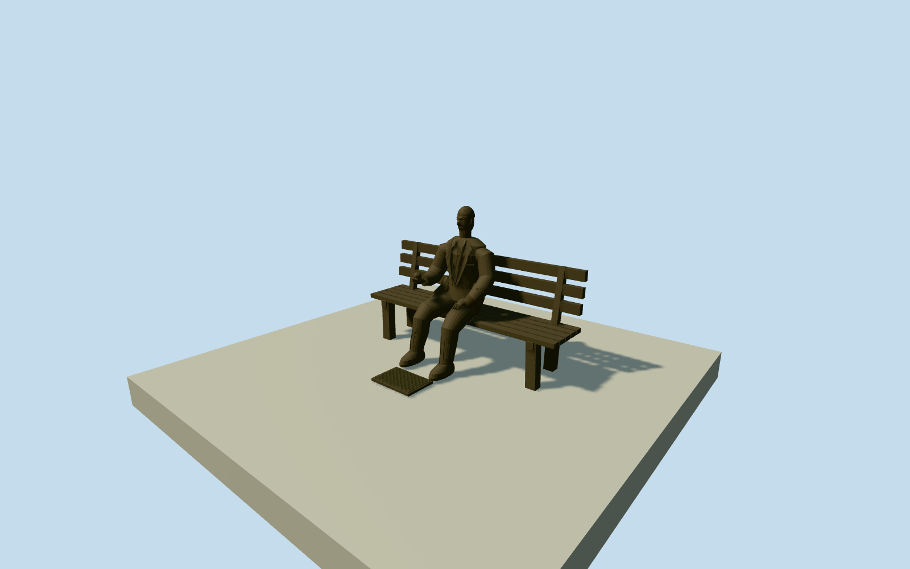

# Alan Turing Memorial

Complete intrinsic life-size seated bronze Turing portrait on open3backboard/5seatboard cast-bronze bench: natural face/hair/ears, jacket/notchedlapels/open-collar shirt, trouser folds/low shoes, anatomicalright cuppedapplehand/viewerleft and lefthandonthigh; small low unlettered plaque. No wholepark/path/slab, otherbenches, people, text or temporary nailpaint.

Authoring state: **review-in-qa.json**. Current completion evidence is in [qa.json](qa.json) and the [completion ledger](../../../../qualla-structures/batches/qualla-002.PROGRESS.md).

- [Alan Turing Memorial](https://qualla.com/alan-turing-memorial/)

Exact native memorialnode1295097482/Q3736114identifies Alan Turing Statue,materialbronze,artistGlynHughes,subjectQ7251. It is a point identity, not a surveyed bench footprint or a park roof. Native adjacent closed footway1185586557provides context/approach only. Bench/figure/plaque dimensions and bounded outline are photographic/anthropometric estimates; signed heading toward original circular-path centre is a provisional photograph/context registration, not a native surveyed statue bearing. Whole park/path never extruded.

Exact two native already-published KGGucwa2008own-workPD-selforiginals control original sculptural geometry. Fullbody photo uses independently pinned primary creator grant because legacy Qualla category metadata omits PD; exact published bytes/nativeSHA1match. Opposite-side portrait has ordinary acceptedpublished metadata. No imported scan, copiedphototexture, generated bitmap, outside image source, pinknailpaint or lettering.

Estimated2.35mbench/.46mseat/1.52mseatedheadtop, portrait/pelvis/limbs and slightheadturn derived from inspected photographs and natural adult seating proportions; no measured sculpture scan. Original sectionedclothing/anatomy, eyelids/nose/brow/closedmouth/ears/shortpartedhair and jointedfingers are bounded medium-fi interpretations. Concealedrear/finehair/fold census and exactportrait likeness are approximate.

Three backboards/five seatboards/four feet and all primary slat gaps retained at everydistance. Rightapplehand is viewerleft/local-X; otherhandrestsonthigh. Shirt/notchedlapels, cuffs/coat tails, broad shoes/soles and smallunletteredgroundplaque included. Raised cloth/face detail reduces withdistance; uniformbrown/olivebronze uses sharedcast-bronzegraph, no paintedeyes/shadows.

Native pointQ3736114 fixes identity/location; nearby circularfootway is contextonly and nevera solidroof/park slab. Provisional heading faces original pavedapproachcentre and2.5mestimatedenvelope is notanOSMsurvey. Raw60mproviderfield/fixedpavedcontact frozenbeforegeometry; exactfooting/plaque/hostgrade remainsunverified. FlatstageY-.17 shows sculpture independently, not surveyedparkcontact.

Build: `node packages/worldgen/scripts/generate-authored-places.mjs --ids=alan_turing_memorial`. Add `--check` to verify exact regeneration. 11220 triangles; 1 materials; no embedded photographs.
