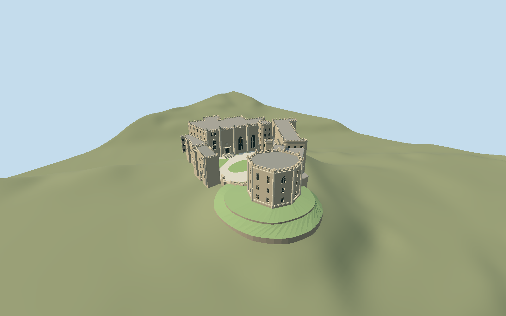

# Durham Castle

Durham Castle exterior: Great Hall and four domed octagonal turrets, Black Stairs, low Tunstall Gallery with upper hall, polygonal clock stair, chapel, separate raised octagonal keep, open gatehouse passage, and landscaped open bailey.

## Evidence and reconstruction

Published dimensions and reconstructed details are separated in spec.json. Primary references:

- [Reference](https://historicengland.org.uk/listing/the-list/list-entry/1121383)
- [Reference](https://historicengland.org.uk/listing/the-list/list-entry/1160921)
- [Reference](https://historicengland.org.uk/listing/the-list/list-entry/1322868)
- [Reference](https://historicengland.org.uk/listing/the-list/list-entry/1322867)
- [Reference](https://dur.ac.uk/things-to-do/venues/durham-castle/history-and-architecture/external-architecture-overview/)
- [Reference](https://dur.ac.uk/things-to-do/venues/durham-castle/history-and-architecture/norman-castle/)
- [Reference](https://www.openstreetmap.org/way/81522967)

No third-party geometry, photograph or bitmap texture is embedded. Shared surface graphs come from the central library; vertex tints carry model colors. Glazing uses PBR materials; transparent surfaces are declared per model.

## Model and axes

29,885 triangles; 65,025 vertices; 6 material groups; 2,703,140 bytes. Native bounds: -49.317, -16.284, -34.022 to 67.839, 34.393, 70.684. Source hash: `sha256:73b88ba498c26a91599d7dd67edd01fb0919e4f691fa66cebde394c8eaf1d1b1`.

{"up":"+Y","longitudinal":"+X 30.047 degrees north of east","front":"Open bailey toward native +Z; keep toward +X,+Z","origin":"Signed main-range anchor; Y0 decoded63.0892 m working datum."}

Fresh Durham Castle Q752266 main way81522967 v38, keep81522969 v15, gatehouse81522972 v13 and chapel81522956 v6 sign heading0.524419899749 at [-1.576564741,54.775561357]. Native +X northeast bearing59.952953 degrees; +Z southeast149.952953 degrees. Great Hall toward -X, gallery/north range -Z, raised keep +X,+Z and southern gatehouse -X,+Z preserve component separation. University actual courtyard, keep/motte and view-from-keep photos inspected; medieval reconstruction drawing is a different state. Two changed main vertices project onto fresh boundary; disappeared service block1435108879 excluded, current court/gate rings recorded. Original main/court cached vertex-to-current-vertex distance4.22 m reflects a small4.105 m² plan revision; horizontal placement is not a surveyed facade. Numeric ground16641 samples on3 m grid, decoded working datum63.0892 m. Court3.9693 m/common shift3.8493 m and separate keep14.1927 m/shift4.1927 m are independently fitted to occupied ground plus0.25 m. Retaining paths support bounded interpreted shelves with terrain-buried toes; original whole-landscape slab is absent. No cut or whole-hill replacement.

## Reproduce

Run `node packages/worldgen/scripts/generate-signature-towers.mjs --ids=durham_castle` (or add `--check`). The generator preserves manually edited masters by checking their baseline hashes. Import through the standard authored-model workflow with optimization disabled; then capture all QA cameras, including shared-surface views.

## Pending work

- Original193007-triangle /16407064-byte master reproduces at sha256:7fee2a5d8b31bbce3e59a071d8eeb7a8db12714ef718b19592cb1b84aaf4f6a8 from unchanged durham-castle-model.mjs#durhamStudy.build and original map-parts.json.
- Fresh Durham Castle Q752266 main way81522967 v38, keep81522969 v15, gatehouse81522972 v13 and chapel81522956 v6 sign heading0.524419899749 at [-1.576564741,54.775561357]. Native +X northeast bearing59.952953 degrees; +Z southeast149.952953 degrees. Great Hall toward -X, gallery/north range -Z, raised keep +X,+Z and southern gatehouse -X,+Z preserve component separation. University actual courtyard, keep/motte and view-from-keep photos inspected; medieval reconstruction drawing is a different state. Two changed main vertices project onto fresh boundary; disappeared service block1435108879 excluded, current court/gate rings recorded. Original main/court cached vertex-to-current-vertex distance4.22 m reflects a small4.105 m² plan revision; horizontal placement is not a surveyed facade. Numeric ground16641 samples on3 m grid, decoded working datum63.0892 m. Court3.9693 m/common shift3.8493 m and separate keep14.1927 m/shift4.1927 m are independently fitted to occupied ground plus0.25 m. Retaining paths support bounded interpreted shelves with terrain-buried toes; original whole-landscape slab is absent. No cut or whole-hill replacement.
- Three-meter diagnostic grid samples a coarse public raster; pixel interval is not verified native resolution or surveyed vertical accuracy. Datum/vintage and under-building contamination remain unverified. No outlier filter is used.
- Court floor is maximum occupied court sample plus0.25 m; separate keep floor is maximum occupied keep vertex plus0.25 m. Common range shift and separate keep shift preserve relative source architectural proportions. Intermediate motte shelves are reconstructed, not surveyed.
- The two mapped motte retaining paths define interpreted bounded skirts/shelves, not an entire castle-hill replacement. Host terrain is retained; no ground cut or whole-landscape slab. Exact rear building grades and cellar levels are unresolved.
- Original193007-triangle detailed master and original plan file remain unchanged; independent derivative reconciles current plan changes and removes disappeared small service feature1435108879. Main range slice topology projects changed old vertices onto the fresh outline, preserving authored facade arrangement.
- Accepted medium-fi exterior: west Great Hall with four octagonal ogee-capped turrets, oriel/Cosin porch; Black Stairs, low gallery with taller north hall, clock stair, chapel, separate raised octagonal keep with corner buttresses, genuinely open southern gatehouse, landscaped roofless bailey and bounded motte retaining shelves. Exact window rhythms/tracery, heraldic/figurative carvings, roof junctions and rear elevations are reconstructed; figurative angel/arms remain abstract reserves, not generic statues. Interiors/Norman vaults, Cathedral, Palace Green Library and wider city are outside scope.
- Four reusable graphs supply sandstone, wood, painted metal and slate. Sandstone tints also supply carved trim/court surfaces; opaque glass and grass remain local color slots. No embedded images. Ordinary masonry/leadwork use shared surfaces, skyline uses baked common linear means.
- Public coarse ground cannot resolve surveyed motte shelves, rear/under-building floors, cellar levels or exact foot placement on every host terrain. Retaining crest allowances1.2 m, shelf shapes and stair proportions are interpreted. Physical laptop/phone timings remain pending.

This bundle follows the medium-fi standard. Medium-fi appearance and geographic fit are reviewed separately. Hash-bound visual acceptance is recorded separately after capture inspection.

## Additional geographic data

Map data © OpenStreetMap contributors, ODbL-1.0. Original deterministic geometry; no reference photos or third-party meshes embedded.
