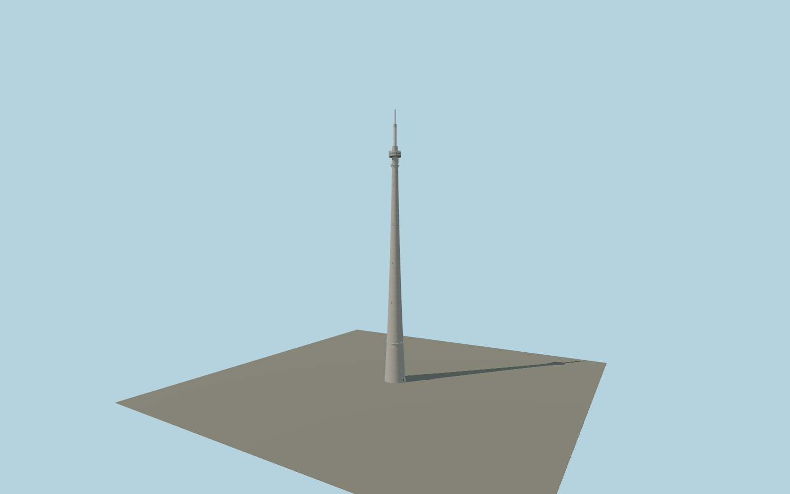

# Emley Moor transmitting station

Individual tapered concrete broadcasting tower, 20-bay glazed turret, four lower cantilever platforms, antenna mounting rings and modern shortened two-stage radome. True shaft-door recesses, cabin windows, panel frames, safety rails, ladders and obstruction lights use shared procedural surfaces.

## Identity and geometry

Catalog emley_moor_transmitting_station, [Q638586](https://www.wikidata.org/wiki/Q638586). Arup original sections set concrete dimensions and cabin rhythm; dated February/September 2023 photographs set the current antenna envelope and mounting details. The mapped circular footprint supplies a center but its 17.6 m diameter conflicts with the published 24.38 m base; it is not a sizing source.

Native +X east,+Z south and +Y up; heading0. mb21 dated2014 survey explicitly locates eight-tier crossed rack on north and two trough antennas on west; September2023 close-up corroborates their configuration. Arup1972 Fig4 north arrow locates four GPO platforms on north. Entrance approximately east is inferred from ground photo with north platforms to its right, uncertainty20degrees; no exact door bearing is claimed.. +X approximately east-facing entrance; +Y is up. The geographic proposal identifies its anchor and orientation evidence separately from remaining terrain and azimuth uncertainty.

Source facts and measured references are recorded in spec.json. References: [1](https://www.arup.com/globalassets/downloads/arup-journal/the-arup-journal-1972-issue-1.pdf), [2](https://historicengland.org.uk/listing/the-list/list-entry/1350339), [3](https://www.arqiva.com/news/end-of-an-era-emley-moor), [4](https://tx.mb21.co.uk/gallery/gallerypage.php?txid=336&pageid=4299), [5](https://tx.mb21.co.uk/gallery/gallerypage.php?txid=336&pageid=4370), [6](https://tx.mb21.co.uk/gallery/gallerypage.php?txid=336&pageid=32), [7](https://tx.mb21.co.uk/gallery/gallerypage.php?txid=336&pageid=1851), [8](https://www.openstreetmap.org/way/476925020). Reference pages and images are not redistributed.

## Original source and shared materials

Geometry is authored in `packages/worldgen/scripts/emley-moor-model.mjs`. Shared material graphs with metric repeat UV0 and original vertex tints; GLB PBR fallback remains self-contained. No per-model texture duplication. No third-party mesh or photograph is embedded.

271,260 triangles; 515,498 vertices; 4 material groups; 21,815,884 source bytes. Source hash: `sha256:de4f70d0099c207de14fe9321d3e719abdd586b466f8ebc676f487e64f97e07a`. Geometry validation checks finite Float32 coordinates, indices, triangle area and winding before export.

Regenerate with `node packages/worldgen/scripts/generate-heritage-towers.mjs emley_moor_transmitting_station`; add `--check` for reproducibility. The generator refuses to overwrite a master whose hash differs from source.json. Import uses `--no-optimize` to preserve facade recesses.

## Remaining detail and review

- Arup1972 sets concrete274.32m,24.38m base/6.4m top and20-bay turret. The mapped17.6m ring is a position control, not a sizing survey. The modern319m modeled antenna envelope is photo-proportioned from February/September2023, not a verified measured current height; owner2023 still quotes historical330.4m. Segment heights, turret external7.05m radius, service-door phases, minor antenna inventory/cage details and entrance east bearing are reconstructed. Lower gallery uses2011 and upper arrays2023 references; detached station buildings, ducts/fences, hidden internals and operating radio equipment excluded. Host terrain supplies ground height; no footprint replacement. Original master is preserved separately.

Named near/far cameras are included for lit visual review. A valid export is not maximum-fidelity certification.
