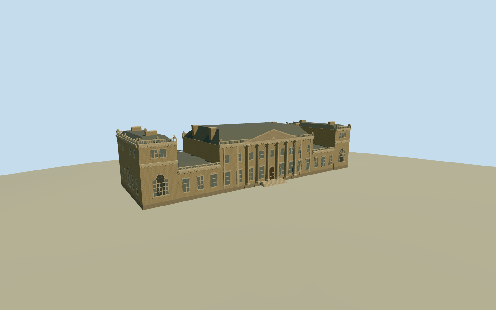

# Harewood House

Harewood House with its nine-bay Palladian center, columned pediment, Venetian-window pavilions, and attached double garden stair.

Authoring state: **review-in-qa.json**. Current completion evidence is in [qa.json](qa.json) and the [completion ledger](../../../../qualla-structures/batches/qualla-004.PROGRESS.md).

- [Harewood House](https://qualla.com/harewood-house/)

Scope covers the house and its attached exterior steps. The free-standing sculptures, wider gardens and stable buildings are separate structures.

The fine reliefs, roof fittings and unsurveyed vertical dimensions are approximate.

Build: `node content/worldgen/source/places/gc/gcw/harewood_house/models/generate-harewood-house.mjs`. Add `--check` to verify exact regeneration. 18491 triangles; 6 materials; no embedded photographs.
