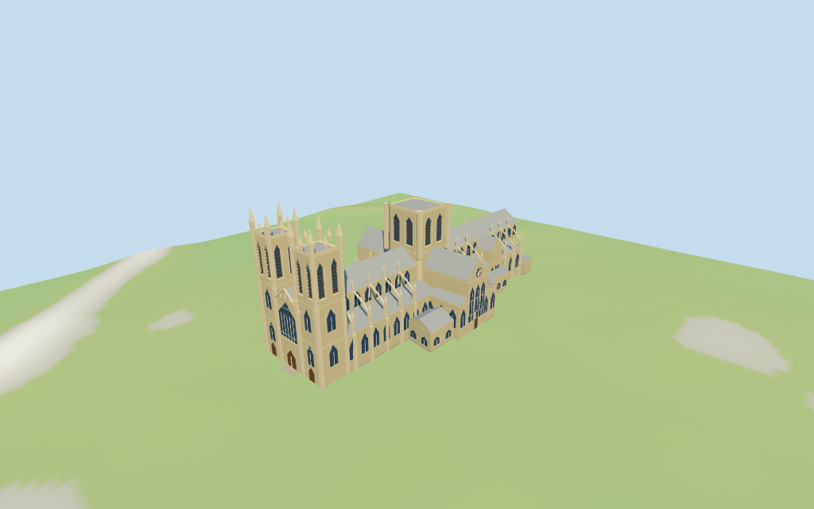

# York Minster

Individual York Minster exterior: pinnacled twin western towers, great west window/three closed portals, broad flat crossing tower, long lead-gray nave/choir, stepped aisles/flying buttresses, gabled transepts/rose and northeast octagonal chapter house with its steep pyramid roof.

## Evidence and reconstruction

Published dimensions and reconstructed details are separated in spec.json. Primary references:

- [Reference](https://www.aboutbritain.com/YorkMinster.htm)
- [Reference](https://commons.wikimedia.org/wiki/File:YorkMinsterWest.jpg)

Four existing shared256-square limestone/raw-stone/standing-seam/wood graphs, metric UVs and linear tints; flat vertex-colored glass and no embedded images.

## Model and axes

15,521 triangles; 46,563 vertices; 6 material groups; 1,866,320 bytes. Native bounds: -82.100, -0.684, -52.256 to 81.899, 63.700, 42.866. Source hash: `sha256:a5a9f4e507c8ee960e87cefc9c69a4dd036756bbd6e80ac2a7a538c6688eff64`.

{"x":"east along nave from twin western towers","y":"up","z":"south across nave"}

Individual exterior from two useful pictures and standard viewer PMTiles/DEM. NativeY0 follows15.794474m standardDEM; estimated floor0.7m clears coarse perimeter-0.33..0.36m. Foundation/plaza/doorstep joins remain approximate; no surveyed thresholds or certified walking surfaces.

## Reproduce

Run `node packages/worldgen/scripts/generate-additional-landmarks.mjs --ids=N0335` (or add `--check`). The generator preserves manually edited masters by checking their baseline hashes. Import through the standard authored-model workflow with optimization disabled; then capture all QA cameras, including shared-surface views.

## Pending work

- Current PMTiles nominal nave/transept35m, aisles22m, choir cross-range30m, chapter-house26m and three tower bodies54m retained. Seven small western tower parts control54..63m pinnacle stages; missing eighth corner follows the pictured symmetry. Eaves, parapets, buttresses, window/door rhythm, chapter passages and lower annex heights are picture-led estimates. Nominal tower heights have not been surveyed.
- Individual exterior from two useful pictures and standard viewer PMTiles/DEM. NativeY0 follows15.794474m standardDEM; estimated floor0.7m clears coarse perimeter-0.33..0.36m. Foundation/plaza/doorstep joins remain approximate; no surveyed thresholds or certified walking surfaces.
- Exact sculpted figures, rose/heart tracery, inscriptions, gargoyles, complete interiors and temporary east scaffolding excluded. Closed panels/doors and selected tower reveals are exterior approximations; no certified walking surfaces. Physical laptop/phone timing pending.
- Skyline retains three towers, west corner pinnacles and chapter-house pyramid with closed stages and mean-tinted surfaces. District restores shared textures and broad windows/buttresses; street restores selected belfry cuts, flying arches and west/transept window rhythms; closeup refines curves, louvers, mullions and trim. Detail changes remain visible.

This bundle follows the medium-fi standard. Medium-fi appearance and geographic fit are reviewed separately. Hash-bound visual acceptance is recorded separately after capture inspection.

## Additional geographic data

©OpenStreetMap contributors; Protomaps; Mapzen/USGS terrain tiles.
