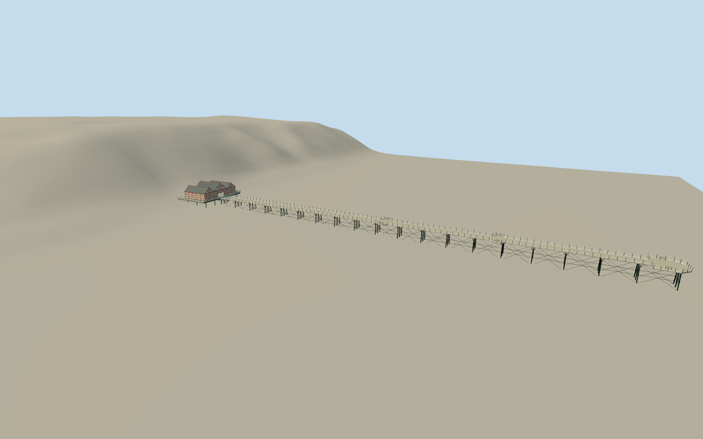

# Saltburn Pier

Surviving shortened timber pier on20 open triple iron trestles with flanged pipes/outward-raked outer feet/cross rods, grey board deck, black curved posts/four white rails/kickboards, two pairs of side viewing bays/benches and widened open head. Integral cream/burgundy three-gabled1925 entrance arcade with taller central roof, slate/perforated terracotta cresting, diagonal/diamond timber panels and three shallow front bays. No lost seaward shelter/length, cliff lift or neighboring shore buildings.

Authoring state: **review-in-qa.json**. Current completion evidence is in [qa.json](qa.json) and the [local 100 ledger](../../../../qualla-structures/batches/PROGRESS.md).

- [Saltburn Pier](https://qualla.com/saltburn-pier/)

Plain entrance apron from dry promenade to front platform is a bounded authoring interpolation, not a surveyed pavement/ramp detail.8m source-grid interpolation has about.13m difference at the exact native dry reference. Ground is not altered to fit geometry.

Selected surviving exterior corroborated by seven exact named Ownwork/self-CC0April2016natives after Qualla-first local scan. Independent mapped dimensions/plan retained. New round white rails/solid kickboards/continuous curved cast posts,40shaped timber haunches andsix course-divided slate roof planes are original medium-fi interpretations. Fine profiles,roof weathering/counts,bench/crest details,station spacing and unmeasured heights remain proportional estimates,not scans or engineering drawings. Historical private/attribution-only controls excluded from current reference inventory.

Primary current pier length is about207m; map gives about201.5m open deck beyond arcade,216m including arcade and220.5m including front platform. Definitions/chainages differ; original outline retained without stretching to nominal dimensions.20 equally spaced transverse trestles remain estimates. Original story1250ft relates to an earlier length. No surviving end shelter is shown in inspected references.

Independent terrain remains unchanged. Coastal composite and8m review interpolation do not certify tide/seabed, vertical datum or embedment. Deck.3m/fixed support bottom-8m are bounded authoring poses. Geographic preview requires current separate review; footprint replacement disabled.

Includes integral own three-gabled entrance arcade; excludes cliff lift/stations/track, neighboring larger three-gabled venue/shops, beach/sea/water/boats, people/bins/life rings/flags/advertisements and interiors. Perforated ridge/diamond motifs and plain glyph marks are original simplified geometry. No photograph or drawing pixels embedded.

Build: `node packages/worldgen/scripts/generate-authored-places.mjs --ids=saltburn_pier`. Add `--check` to verify exact regeneration. 60364 triangles; 7 materials; no embedded photographs.
