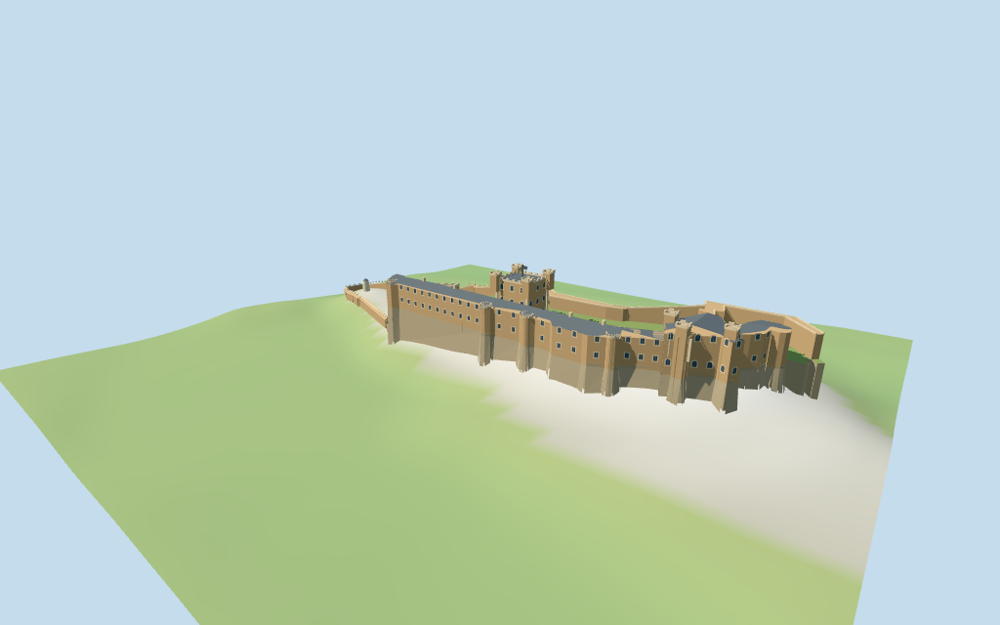

# Bamburgh Castle

Individual elongated coastal castle: freestanding square keep with four corner crowns and paired arched windows; long roofed palace, unequal eastern hall towers and rounded return; separate north curtain and lower west gate, open stepped courts, rocky foundations and a low western windmill.

## Evidence and reconstruction

Published dimensions and reconstructed details are separated in spec.json. Primary references:

- [Reference](https://marinas.com/view/landmark/xqspg_Bamburgh_Castle_Landmark_Bamburgh_GB_United_Kingdom)
- [Reference](https://www.paullettgolden.com/post/bamburgh-castle)

Five existing256-square shared material graphs provide sandstone, weathered limestone, slate, painted metal and lime plaster. Glass/lawn use linear vertex colors. Metric UVs and shared-tint compensation; no unique bitmap or embedded photo.

## Model and axes

9,959 triangles; 29,877 vertices; 7 material groups; 1,199,204 bytes. Native bounds: -171.106, -25.627, -44.551 to 169.917, 39.200, 44.947. Source hash: `sha256:a9ee21f63b837c49a48de63b4fe531c9115bf7674f73a959b2ff497933854d15`.

{"x":"southeast along castle","y":"up","z":"southwest toward village and palace frontage"}

Retained exact-QID enclosure and six current component identities provide approximate horizontal control; MultiPolygon pieces are independent. Two oblique photographs guide exterior profiles and signed facing. Standard viewer DEM fixes the working anchor datum; terraces, deep foundations and gate joins are approximate. © OpenStreetMap contributors, ODbL-1.0.

## Reproduce

Run `node packages/worldgen/scripts/generate-additional-landmarks.mjs --ids=bamburgh_castle` (or add `--check`). The generator preserves manually edited masters by checking their baseline hashes. Import through the standard authored-model workflow with optimization disabled; then capture all QA cameras, including shared-surface views.

## Pending work

- Mapped enclosure and seven component polygons provide approximate exterior horizontal fit; no component height tags, so tower heights, roof profiles, window rhythm and gate openings are picture-led estimates.
- Standard viewer DEM gives a working41.1229m datum. The western bailey slope, inner courtY6.5m, foundations, rock skirts, paths and gate joins are approximate; coarse terrain is not a bare-earth survey or certified navigable surface.
- The north-curtain/west-gate MultiPolygon is preserved as independent masses. Village, dunes, separate southwest building, full interiors and hidden archaeological plans are excluded.
- Windmill reconstruction is its present exterior tower/cone; no historical sails or mechanism are invented.
- Physical laptop and phone frame-rate measurements remain pending.

This bundle follows the medium-fi standard. Medium-fi appearance and geographic fit are reviewed separately. Hash-bound visual acceptance is recorded separately after capture inspection.

## Additional geographic data

© OpenStreetMap contributors; Protomaps; Mapzen/USGS terrain tiles.
