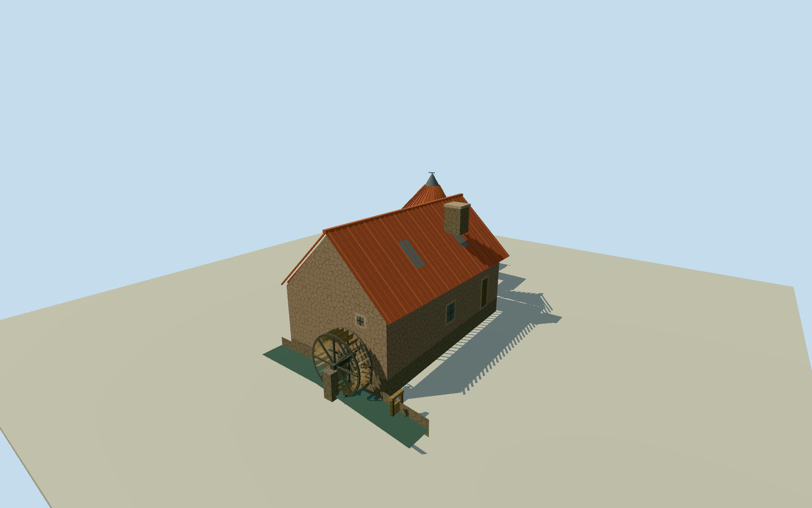

# Preston Mill, East Linton

Preston Mill in East Linton with its rubble watermill, leaning pantile kiln and undershot wheel beside the mill lade.

Authoring state: **review-in-qa.json**. Current completion evidence is in [qa.json](qa.json) and the [completion ledger](../../../../qualla-structures/batches/qualla-003.PROGRESS.md).

- [Preston Mill](https://qualla.com/preston-mill/)

Spring 2008 exterior. The wheel and sluice are static. The visitor building, nearby millpond and separate doocot are outside the model.

Roof pitch, detailed rubble, kiln lean, sill elevations and the lade section are approximate where the photographs and mapped outlines leave gaps.

Original terrain samples remain unchanged. A small ground opening follows the wheel channel beneath the modeled section of mill lade.

Build: `node content/worldgen/source/places/gc/gcy/preston_mill/models/generate-mill.mjs`. Add `--check` to verify exact regeneration. 2244 triangles; 5 materials; no embedded photographs.
