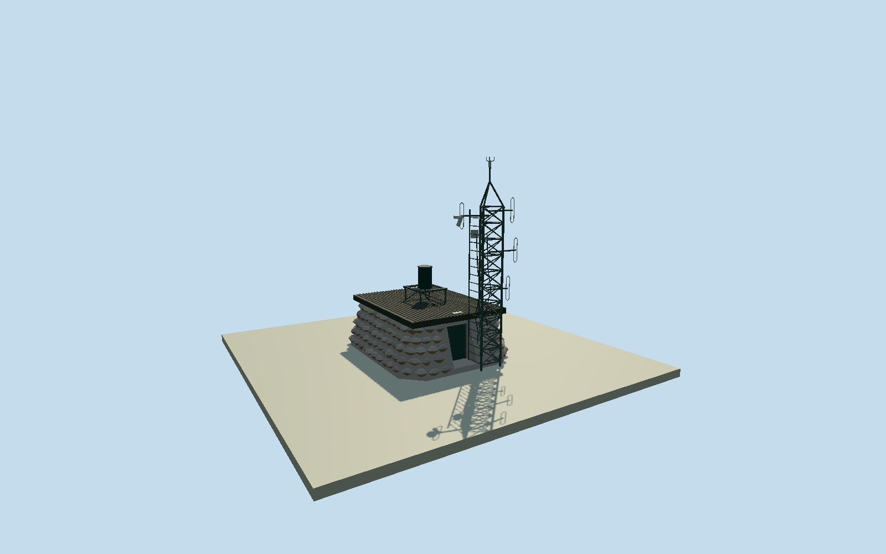

# Cairn Gorm summit weather station

Whole summit weather-station structure: low battered granite radio hut/revetment with flat ribbed roof and actual recessed closed access door; rooftop heated AWS cylinder/open gantry and adjoining open triangular weather/radio mast, ladder, crossbracing, sensor booms, antenna loops and cable runs. Native named mast point anchors an explicitly estimated hut plan and bearing. Natural mountain/rockfield, separate summit cairn, distant funicular/ski buildings, signs/QR/plaque copies and interiors excluded.

Authoring state: **review-in-qa.json**. Current completion evidence is in [qa.json](qa.json) and the [completion ledger](../../../../qualla-structures/batches/qualla-002.PROGRESS.md).

- [Cairn Gorm](https://qualla.com/cairn-gorm/)

Native named tower node35925144 at-3.6439614,57.1163542 anchors the weather-station mast, separately from naturalpeak35925143/Q1025927 and distant funicular. No native building outline, height, surveyed hut plan or facade azimuth. Native +Xeast/+Zsouth/heading0 preserved; point marker never presented as a measured footprint. Relative hut/mast orientation interpreted from the two cleared camera directions, proportions/hidden elevations estimated only after independent field freeze.

All floor/section/geometry choices follow immutable independent400m129x12916641sample original source field/one rawtile freeze. Floor0 uses the fixed SW local[-8,8] provider-relative datum, not a surveyed threshold. Native mast point remains[0,0]; hut center estimated[.9,2.8]m, north access/longside orientation inferred from the two cleared camera directions. No surveyed footprint/dimensions/bearing exist. Original approx4.6x5.7m stone revetment,1.86m flat roof,7.18m complete mast/sensor and heated cylinder/gantry sections are original photo-based estimates. Closed recessed door sits behind sloping stone wall; exact depth varies with wall batter. Stone census/profile/hidden rear wall/booms/sensors/currentfinish are bounded estimates. Both adjoining station systems/shared hut retained; no natural mountain/rockfield/distant ski-railway model. No fitting/flattening/reacquisition or subsequent model raising; geographic contact remains preview/unresolved.

One exact published2021 Mx.GrangerCC0/own hero and one independently verified same-creator/same-day CC0/own second exterior establish both adjoining weather systems and shared host hut. No protected Geograph/operator/research photographs or drawings adopted; primary text used only for station/host identity. No copied pixels/generated photographic textures, plaque/sign/QR copies, questionable sources or article/media/rightsmetadata repairs. Stone census and hidden walls/precise plans/member proportions/sensors/currentfinish are bounded original estimates.

Independent400m129x12916641sample original field/one rawtile frozen before floors/sections/geometry. Fixed1234.7204m SW provider-relative datum is distinct from published summit altitude; neither certifies this unsurveyed doorway/foundation. Source ground never fit/flattened/reacquired and model never raised to hide defects. All placement stays preview/replaceFootprint=false; exact grade/contact unresolved. Flat stage and neighborhood are synthetic review fixtures.

Build: `node content/worldgen/source/places/gf/gfj/cairn_gorm_weather_station/models/generate-cairn-gorm-weather-station.mjs`. Add `--check` to verify exact regeneration. 15248 triangles; 4 materials; no embedded photographs.
