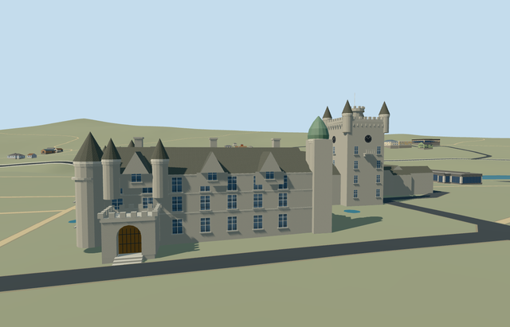

# N0750 — Balmoral Castle

Reviewed 2026-10-22. **Complete as a medium-fi mapped exterior with approximate native fit.**

## Built and inspected

Balmoral Castle medium-fi exterior follows its connected mapped outline, five integral parts and open courtyard. Pale granite residence, slate roof ranges, three west crow-step gables, conical end turrets and supported bartizans, genuine arched south entrance recess and separate treads, green rounded cupola, tall clock tower with corner cones/circular crown, schematic clocks, corbels and balcony. Two ordinary south/west photos guided one continuous pass. Corrected western window tiers, rounded the cupola, fixed initially flat stair tops and stabilized coincident map edges before final captures.

## Shared surfaces and browser LODs

Five existing 256px graphs across eight authoring roles: stone_granite walls and trim, slate roofs, storefront opaque glazing, metal_painted frames/cupola/dials and wood_plain entrance. No new graph, private atlas or embedded image. Six textured draws near, one skyline draw. Palette colors are linear in the GLB, UVs are metric and each requested graph is read once. Every LOD unload releases all model geometry; shared graph lifetime remains managed by the viewer.

| Level | Triangles | Bytes | Draws |
| --- | ---: | ---: | ---: |
| skyline | 902 | 81,616 | 1 |
| district | 3,776 | 313,156 | 6 |
| street | 7,474 | 616,880 | 6 |
| closeup | 8,554 | 696,804 | 6 |

Four authored LODs contain 902 / 3,776 / 7,474 / 8,554 triangles. Initial skyline plus district geometry is 394,772 bytes; close-up is 696804 bytes. Separate POSITION/NORMAL streams and equal CPU/GPU accounting; six GLBs with zero Khronos errors/warnings, 46 mesh/contact probes, 31 actual PMTiles13/14/15 cases and 48 inspected frames. Economy/High, noon/late light, untextured silhouette and four-level transitions reviewed. Physical laptop/phone/tablet and dense-city timings remain pending.

## Geographic placement

Approximate exterior native fit accepted on the unchanged standard 201x201/6m terrain. Q42049 and named relation14213231/native52776572346479 identify the castle; integral ways1093652302/2304/2305/2306/2308 supply five body controls. Internal+X follows the mapped east-northeast facade edge and +Z faces the south-southeast lawn, with heading0 baked into world east/south geometry. Six owned records are replaced, preserving all 64 independent resident / 68 wider estate buildings. Boundary grades span -0.955 to +0.548m relative to the south control; working floor sits0.7m above it, with modest foundation exposure and three separate entrance treads. Only occupied floor partitions cut ground; mapped courtyard, approach/provider and all original roads/water119893.07m² remain intact. Coordinates rounded to one micrometre avoid an actual level14 clipping failure. Failure retains all70 original resident buildings; all LOD unloads restore ground/water and zero live geometry. Exact thresholds/accessibility and height semantics remain unverified; no custom terrain or broad flattening.

## Fidelity and limits

Recognizable medium-fi exterior completed using the mapped connected footprint and two ordinary south/west pictures. Map heights5/8/11/17/23m remain unqualified working body controls. Slate ridge rise4.6m, reconstructed6.5m rear ranges, approximate29m corner cones/27m crown/32m flagstaff, member diameters and window inventories are picture-led estimates. Hidden north/east roofs and openings, interior rooms, exact engineering dimensions and working clocks are unverified or omitted. Rear roofs/fenestration are explicitly simplified proxies. Static original dial marks replace fine inscriptions; royal flag artwork, foliage, garden walls/fountain and independent outbuildings remain outside this model. Physical device timings remain pending.

## Targeted checks

Selected generation/import/placement checks, strict medium-fi, scene validation, sim30 and recipe lint pass. Sim30 sha256:1ec0ddbd34ead1944d5b9f6c93d514f2a84e0807dc96b6cf4306d69a64d0d071. Current pins: [qa.json](qa.json). Editable controls: [map-frame.json](map-frame.json).

## Viewed references

- https://commons.wikimedia.org/wiki/File:Balmoral_Castle.jpg — Stuart Yeates; 2004-07-14; CC-BY-SA-2.0. Viewed only.

- https://commons.wikimedia.org/wiki/File:Balmoral_Castle_3_20211026.jpg — Daniel Kraft; 2021-10-26; CC-BY-SA-3.0. Viewed only.

- https://www.openstreetmap.org/relation/14213231 — named PMTiles building and POI, ©OpenStreetMap contributors, ODbL-1.0. No separate survey or bespoke terrain source.
