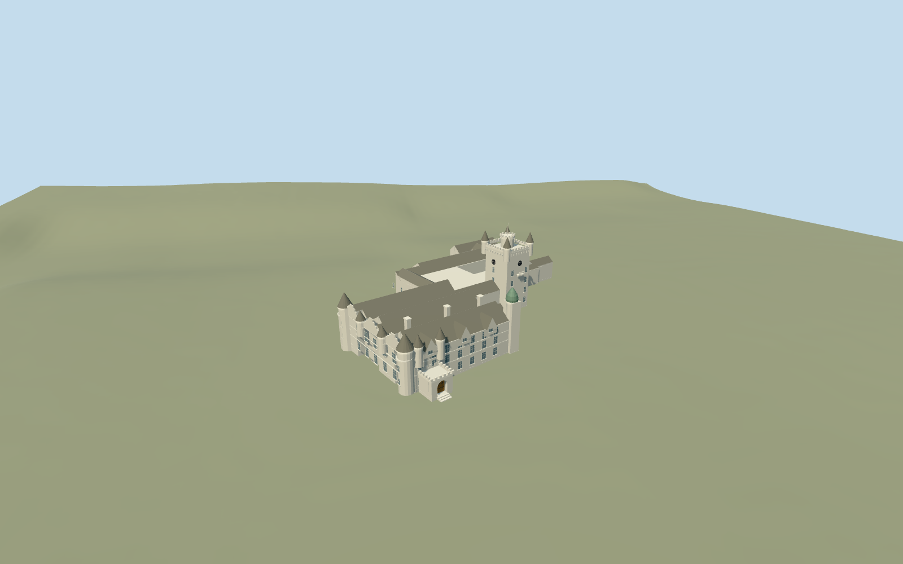

# Balmoral Castle

Balmoral Castle: full connected mapped castle and five height-tagged integral parts, open rear courtyard, pale granite main residence with slate roof ranges and stepped gables, conical/bartizan turrets, south arched entrance porch, small green-roofed southeast turret and tall clock tower with corner cones and round crown. Keep the separate estate offices/outbuildings, gardens, walls, fountain and all unrelated buildings as context.

## Evidence and reconstruction

Published dimensions and reconstructed details are separated in spec.json. Primary references:

- [Reference](https://commons.wikimedia.org/wiki/File:Balmoral_Castle.jpg)
- [Reference](https://commons.wikimedia.org/wiki/File:Balmoral_Castle_3_20211026.jpg)

Balmoral Castle: full connected mapped castle and five height-tagged integral parts, open rear courtyard, pale granite main residence with slate roof ranges and stepped gables, conical/bartizan turrets, south arched entrance porch, small green-roofed southeast turret and tall clock tower with corner cones and round crown. Keep the separate estate offices/outbuildings, gardens, walls, fountain and all unrelated buildings as context.

## Model and axes

8,554 triangles; 21,226 vertices; 6 material groups; 870,632 bytes. Native bounds: -47.199, -1.155, -58.551 to 46.772, 32.900, 61.935. Source hash: `sha256:1c63dcf6c9040a4e141ed2602f0597637487b1abe5b6e688af038060ab0421ee`.

{"x":"east","y":"up","z":"south"}

The geographic proposal uses exact-QID OpenStreetMap evidence. Map-derived orientation and estimated architectural details require real-site visual review; preview eligibility is distinct from geographic/fidelity approval. Map attribution: © OpenStreetMap contributors, ODbL-1.0.

## Reproduce

Run `node packages/worldgen/scripts/generate-additional-landmarks.mjs --ids=N0750` (or add `--check`). The generator preserves manually edited masters by checking their baseline hashes. Import through the standard authored-model workflow with optimization disabled; then capture all QA cameras, including shared-surface views.

## Pending work

- Balmoral Castle: full connected mapped castle and five height-tagged integral parts, open rear courtyard, pale granite main residence with slate roof ranges and stepped gables, conical/bartizan turrets, south arched entrance porch, small green-roofed southeast turret and tall clock tower with corner cones and round crown. Keep the separate estate offices/outbuildings, gardens, walls, fountain and all unrelated buildings as context.
- Q42049 and named PMTiles relation14213231/native52776572346479 identify the connected castle. Integral ways1093652302/2304/2305/2306/2308 supply porch, link, southeast turret, clock tower and main residence, with heights5/8/17/23/11m. Internal+X points east-northeast along the southern residence facade; +Z south-southeast to the lawn. Orientation follows the mapped straight front edge and the inspected south/west photos. World heading0 with geometry baked into east/south coordinates.
- Map heights5/8/11/17/23m are unqualified working body controls. Photo-led main slate ridges rise4.6m above11m eaves; tower corner cones reach about29m, circular crown27m and flagstaff32m. Lower rear wings use a reconstructed6.5m body and3m roof rise. Turret diameters, crow steps, openings, roof sections and unseen north/east details are approximations, not a measured survey. The clock is a static schematic face; no copied lettering, royal flag artwork or furnished interiors.
- Unmodified standard Protomaps20261020 and Mapzen201x201/6m terrain. Uncovered south approach control internal[-43,48], datum286.25030676360484m. Closed castle floor0.7m above this datum and a short three-tread entrance flight; foundation reaches below occupied boundary grades. Ground is cut only beneath exact occupied castle floors; courtyard, approach and independent estate context remain original. Exact thresholds and accessibility remain unverified. Current native south entrance, western residence and rear courtyard views inspected. Approximate exterior fit accepted on the retained standard grid: boundary grades vary by1.50m, covered by the declared foundation/plinth, while entrance treads meet the uncovered south approach. The mapped courtyard remains open, six owned records are replaced and every independent estate building remains intact. Exact thresholds, accessibility, roof inventories and height semantics are unverified. Occupied cutout partitions retain the courtyard; mask coordinates are rounded to one micrometre to avoid coincident-edge polygon-clipping failures in the actual level14 extract.

This bundle follows the medium-fi standard. Medium-fi appearance and geographic fit are reviewed separately. Hash-bound visual acceptance is recorded separately after capture inspection.
