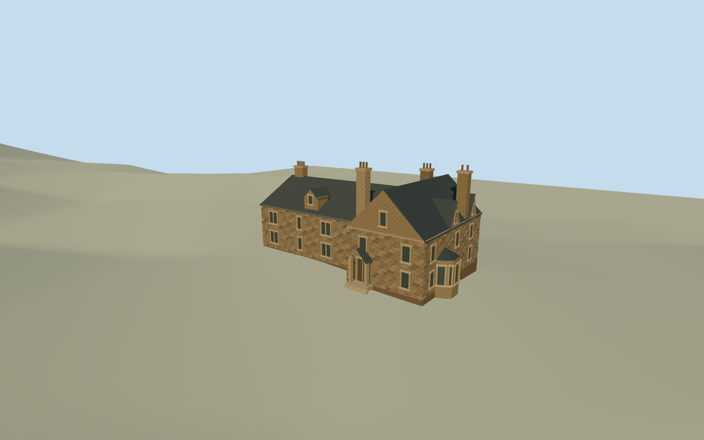

# Loch Maree Hotel

Loch Maree Hotel at Talladale in 1877, with slate gables, paired sash openings, chimney stacks, southeast bay and a small gabled entry porch.

Authoring state: **review-in-qa.json**. Current completion evidence is in [qa.json](qa.json) and the [completion ledger](../../../../qualla-structures/batches/qualla-004.PROGRESS.md).

- [Loch Maree Hotel Botulism Poisoning](https://qualla.com/loch-maree-hotel-botulism-poisoning/)

The model depicts the 1877 exterior described in the story. The later enlargement and present additions are from a different phase.

The original geometry is an estimate registered to the surviving inn. Lake-facing elevations and exact chimneys, masonry tones, roof details and glazing are interpreted.

Build: `node content/worldgen/source/places/gf/gfk/loch_maree_hotel/models/generate-loch-maree-hotel.mjs`. Add `--check` to verify exact regeneration. 18666 triangles; 6 materials; no embedded photographs.
