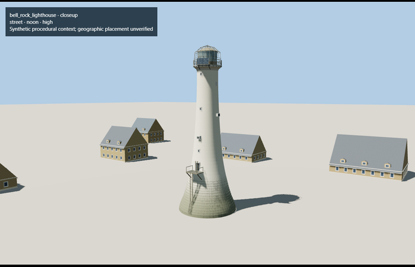

# Bell Rock Lighthouse

Reviewed2026-10-27. Current medium-fi exterior and existing approximate geographic-registration scope pass. **42 current renders inspected; six GLBs validate with zero errors/warnings.**

Inspected all9 current portable views of the preserved detailed master and the existing ordinary Robertson photograph. The white curved tower, broad sea-stained base, small windows/vents, cornice, bronze triangular lantern, copper dome, open bird cage, SSE solar bay and connected landing/ladder remain present. Close lantern and landing views supplement the whole model and four turntables. Master69274triangles/5764748bytes and source/import hashes remain identical to the start of this pass.

Inspected all9 current shared-material and north-up flat-terrain views. Six existing256px plaster/ashlar/granite/painted-metal/wood/concrete graphs are shared; glass remains local opaque PBR. Each model graph loads once and unload disposes every model geometry. No private/embedded image. Existing mapped-center and SSE solar-bay orientation remain unchanged; flat review ground does not establish native reef or water level.

Inspected all24 fresh ACES1.05 medium-fi views: noon/late economy/high, silhouette, lantern/landing/base, district/street lantern, street landing and four level transitions. Four explicit authored levels retain the full36m tapered silhouette, cornice/lantern/dome/cage, signed solar bay and attached access route. The far level uses polygonal profile/color bands and four broad cage ribs; coarse levels intentionally omit fine wire/grid/course detail. Near models use the existing shared graphs. The generic reducer could not meet the district ceiling with its isolated surface topology, so coherent authored levels replace all automatic derivatives.

| Level | Triangles | Bytes | Draws |
| --- | ---: | ---: | ---: |
| skyline | 748 | 55140 | 1 |
| district | 3854 | 291316 | 5 |
| street | 10906 | 778928 | 7 |
| closeup | 24250 | 1699244 | 7 |

Runtime triangles 748 / 3854 / 10906 / 24250;draws 1 / 5 / 7 / 7;initial skyline+district 346456bytes;closeup1699244bytes. Actual caps and separate position streams pass. Error reservations describe authored simplification and are not formal whole-mesh deviation measurements. Physical phone/laptop frame-time measurements remain pending.

## Placement and limits

Exact-QID mapped tower center and primary HES SSE solar-bay direction resolve placement. North-up review confirms the main asymmetry. Door and minor equipment retain documented photo-proportioned azimuth assumptions; host terrain owns reef/water contact. Current north-up shared fixture inspected again; anchor/heading and detailed geometry are unchanged. No new native-water/reef survey is claimed.

- The modeled exterior follows the cited published facts and inspected photographs. Unpublished dimensions and local fittings are explicitly photo-proportioned; no claim of engineering survey accuracy is made.
- Portable PBR and shared metric surfaces are provided. Surface weathering, material color under local lighting and fine facade relief require close render review before maximum-detail acceptance.
- Asset covers the tower and attached equipment; detached reef walkways and landing infrastructure are separate site structures. The date-stamped2005 research photograph and2024 HES description govern visible details; individual repairs and marine staining are not surveyed.
- Existing photo-proportioned exterior and approximate mapped-center/signed orientation. Host terrain supplies reef/water contact; no new water or terrain survey.
- Fine cage/rail/rung/grid density decreases at distance. Source36m height and base controls are preserved; intermediate profiles, fittings and weathering remain photo-proportioned. Native reef, water stage and detached landing infrastructure are host/site context.

## Reproduce

Generate/import this ID with the normal lighthouse pipeline, then generate its LODs. Editable derivative controls are in `review-scope.json` and `models/bell-rock-lods.mjs`. The detailed master remains unchanged. Two focused tests cover preserved source bytes, deterministic derivatives, full height, landing support, signed solar bay, caps and GPU layout. Bulk captures stay local.
