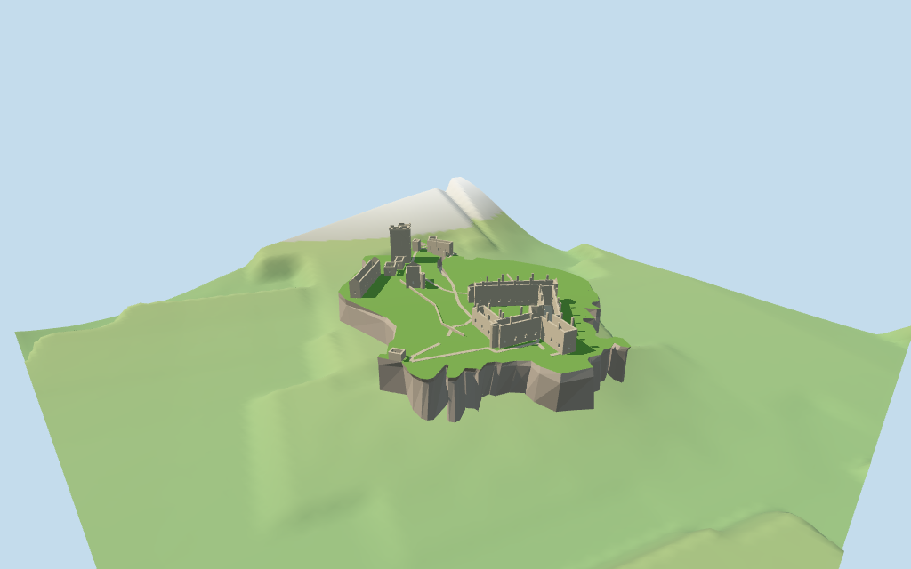

# Dunnottar Castle

Individual ruined headland compound: roofless eastern palace ranges around the mapped basin, western L-shaped tower house, chapel, stables, gate rooms, dividing lawn walls, faceted cliff platform and mapped zigzag stair approach. No restored complete castle roof or filled ruin boxes.

## Evidence and reconstruction

Published dimensions and reconstructed details are separated in spec.json. Primary references:

- [Reference](https://greyarro.ws/t/dunnottar-castle-a-sensible-approach-to-flying-permission/52410)
- [Reference](https://megaconstrucciones.net/?construccion=castillo-dunnottar)

Three existing256-square graphs supply weathered limestone, granite and gravel with linear tints/metric UVs. Grass and small basin water use vertex-colored palettes. No unique bitmap or embedded image.

## Model and axes

14,200 triangles; 42,600 vertices; 5 material groups; 1,707,212 bytes. Native bounds: -94.199, -5.225, -73.425 to 92.331, 43.600, 72.285. Source hash: `sha256:b5fa7321733aa3550ca731296b939d18fab85d04044b50a5ef866a0fd92b902e`.

{"x":"ENE toward palace and sea","y":"up","z":"SSE along coastal flank"}

Two inspected aerial pictures and standard viewer PMTiles/DEM guide the individual ruined compound. Coarse DEM smooths the cliff, so rock platform and approach levels are explicit approximations. Town, ocean, separate offshore rocks and complete interiors remain host content. © OpenStreetMap contributors, ODbL-1.0.

## Reproduce

Run `node packages/worldgen/scripts/generate-additional-landmarks.mjs --ids=dunnottar_castle` (or add `--check`). The generator preserves manually edited masters by checking their baseline hashes. Import through the standard authored-model workflow with optimization disabled; then capture all QA cameras, including shared-surface views.

## Pending work

- Fourteen ruin footprints and basin retain current map controls; room-role correspondence, all heights, gables, chimney damage, windows and partitions are exterior-picture estimates.
- The standard DEM12.3751m anchor is coarse and strongly smooths this headland. Native plateau20m, rock profiles, entrance10–20m stair levels, footing and joins are approximate; no bare-earth survey, terrain carving or certified walking collision.
- Skyline omits minor gate/coastal/end rooms and the detailed stair flights. District restores the selected compound and sparse openings; street/closeup add window rhythm, chimney remnants and stairs. Complete interiors, vaults, complete historical room plans and exact weathering are excluded.
- Modern toilet, ocean, offshore rocks, mainland paths, town, trees, crowds and visitor fixtures remain host content. Basin water level and lawn divisions are simplified interpretations.
- Physical laptop and phone performance measurements remain pending.

This bundle follows the medium-fi standard. Medium-fi appearance and geographic fit are reviewed separately. Hash-bound visual acceptance is recorded separately after capture inspection.

## Additional geographic data

© OpenStreetMap contributors; Protomaps; Mapzen/USGS terrain tiles.
