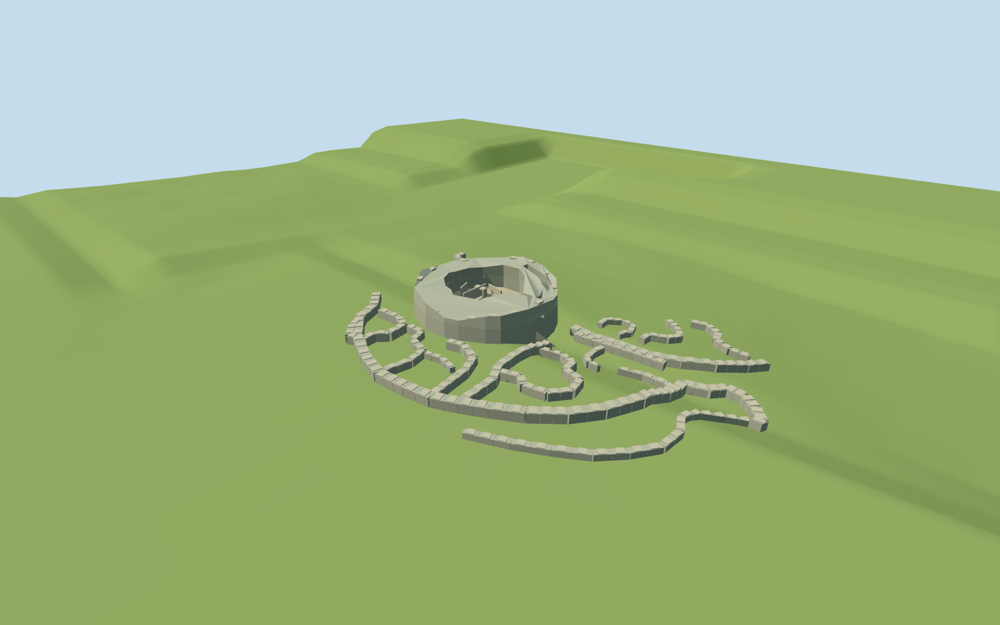
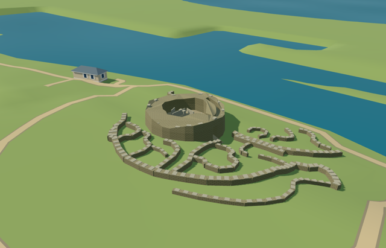

# broch_of_gurness — Broch of Gurness

Reviewed 2026-10-20 in one continuous author/build/inspect/fix round.

## Appearance

Inspected 47 current views during one continuous construction and correction pass. The specific thick irregular annulus, roofless courtyard, open east passage and supported lintel, exposed intramural pocket, upright interior flagstones/shelves/low hearth/covered opening and low settlement/enclosure fragments remain distinct. Ordinary2017/2023 views and a Commons plan image guided the result; no tall intact ancient tower or complete house roofs are reconstructed. During construction replaced rounded fieldstone with existing coursed sandstone, seated cap stones inward, lowered a broken wall section and added a narrow supported gravel passage approach. No missing front faces, sealed courtyard roof or floating visible village wall was observed in the current accepted views.

## Shared materials and browser levels

Four existing shared256-square graphs: stone_sandstone, stone_sandstone_raw, gravel and metal_painted; at most four material draws. Coursed sandstone approximates the real thin layered dry-stone masonry; its regular joints are an explicit shared-library compromise. Continuous raw stone covers modeled slabs without a second block-joint pattern, gravel covers only the bounded courtyard/approach, and painted metal supplies the small covered opening. Shared renders exercise metric surfaces, tinting and graph reuse; each graph is read once and model eviction disposes geometry. Zero embedded images or copied picture pixels. All canonical material refs, six GLB hashes, separate LOD position/normal streams and matching counted CPU/GPU bytes pass.

| Level | Triangles | Bytes | Draws |
| --- | ---: | ---: | ---: |
| skyline | 992 | 103468 | 1 |
| district | 2700 | 259684 | 4 |
| street | 4548 | 423780 | 4 |
| closeup | 6396 | 592476 | 4 |

Inspected 24 medium-fi views covering three distances, noon/late afternoon, economy/high, neutral silhouette, four matched levels and transitions. Skyline keeps the hollow low broch, entrance and main surrounding ruin rhythm; nearer levels add exposed gallery, more village walls and upright/slab details. Terrain checks found a coarse skyline wall crossing a rise; lower levels now subdivide long walls to retain supported ground contact. Levels992/2700/4548/6396 triangles, skyline plus district363152 bytes, below phone3MB/laptop6MB initial targets. Physical laptop and phone timings remain pending.

## Approximate map fit

Retained exact-QID OSM way177755139 describes the broader settlement. The native named Broch Of Gurness ring52776577268228 provides an irregular outer footprint and courtyard hole; the named settlement POI corroborates identity. Anchor-3.081486977,59.123799747/global heading0/native east-south axes; ring center[-.672110585,-11.271226264]m and mean radius9.400546m. The north-up plan supports the east entrance; fine inventory retains20degree/2m uncertainty. Only the generic broch shell is replaced, with zero residual. The one independent visitor building among two native originals, original6m ground/native path inputs and2333959.053339m2 water remain unchanged. Failure restores both originals; all four loaded levels unload with zero live geometry. Peripheral walls follow coarse grade, and no ground/water cutout or coastal terrain slab is authored.

## Limits

Original medium-fi geometry represents visible present-day ruins. No qualified wall height survives in retained/native data; the roughly2.2..3.8m profile,1.72m entrance clearance,2.05m gallery floor and0.65..1.05m peripheral walls are picture/map visualization estimates. Fine stone/block damage, orthostat/shelf/hearth/covered-opening inventory, partial gallery condition, simplified old-plan linework and coarse-terrain foundations remain approximate. The plan supplies arrangement rather than a claim that every1948 feature survives; removed/dashed structures are omitted. Shared coursed stone is cleaner and more regular than real flagstone. Native grassy earthworks remain coarse; no newly measured ditch depth, full historical tower/roof, furnished prehistoric village, copied label/photo atlas, visitor building or whole coast is reconstructed.

## Selected checks

Six Khronos files: zero errors/warnings.462 actual mesh/material/contact checks; 47 current inspected views. Scene validation/sim30 and strict selected medium-fi audit pass. Source/runtime/LOD hashes and material bindings verified.

Rebuild: node packages/worldgen/scripts/generate-additional-landmarks.mjs --ids=broch_of_gurness; node packages/worldgen/scripts/import-structure-models.mjs --ids=broch_of_gurness; node packages/tooling/scripts/generate-landmark-lods.mjs --ids=broch_of_gurness --force.

Source: sha256:e83c040e8fd62e1fdc6bf80c90ffb6d9f3b4714bce0143aec6a9566540db6d74

Runtime: sha256:db4ef9ddb3edda465ef97e46aeb7111b7218e24ec6d0324646063020a139a923

Input: sha256:0e8437f47973091e20e26821a922d581e12825ff0db719599eac80f27f66ccf1

## Viewed ordinary pictures

https://commons.wikimedia.org/wiki/File:Broch_of_Gurness_in_Aug_2024.jpg — Sangwinc; CC-BY-SA-4.0. Viewed only; no pixels copied.

https://commons.wikimedia.org/wiki/File:Broch_of_Gurness_interior_panorama.jpg — Ellievking1; CC-BY-SA-4.0. Viewed only; no pixels copied.

https://commons.wikimedia.org/wiki/File:Broch_of_Gurness_exterior_view.jpg — Ellievking1; CC-BY-SA-4.0. Viewed only; no pixels copied.

https://commons.wikimedia.org/wiki/File:Broch_of_Gurness_ground_plan.jpg — J.S. Richardson; Public domain (expired Crown copyright, as declared by Commons). Viewed only; no pixels copied.
