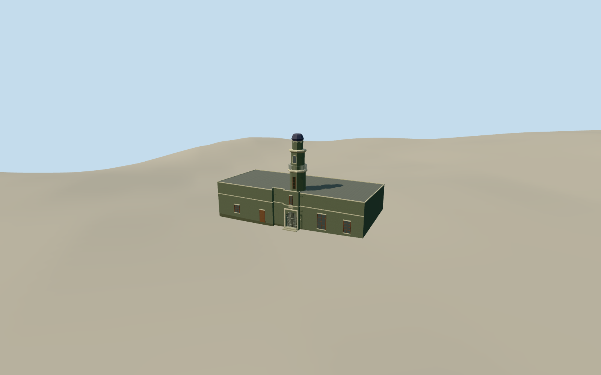

# Auwal Mosque

Auwal Mosque in Bo-Kaap with its olive plaster, cream bands, white arched entrance grille and polygonal minaret with a dark cap.

Authoring state: **review-in-qa.json**. Current completion evidence is in [qa.json](qa.json) and the [completion ledger](../../../../qualla-structures/batches/qualla-003.PROGRESS.md).

- [Auwal Mosque](https://qualla.com/auwal-mosque/)

The model depicts the gray-green frontage and minaret photographed in December 2024. Heights, rear details and the corners outside the cropped view are estimates.

The original elevation field is preserved. The architectural platform and sidewalk registration use approximate contact.

Interiors, freestanding palms, signage lettering and neighboring structures are outside the model scope.

Build: `node content/worldgen/source/places/k3/k3v/auwal_mosque/models/generate-auwal-mosque.mjs`. Add `--check` to verify exact regeneration. 2622 triangles; 6 materials; no embedded photographs.
