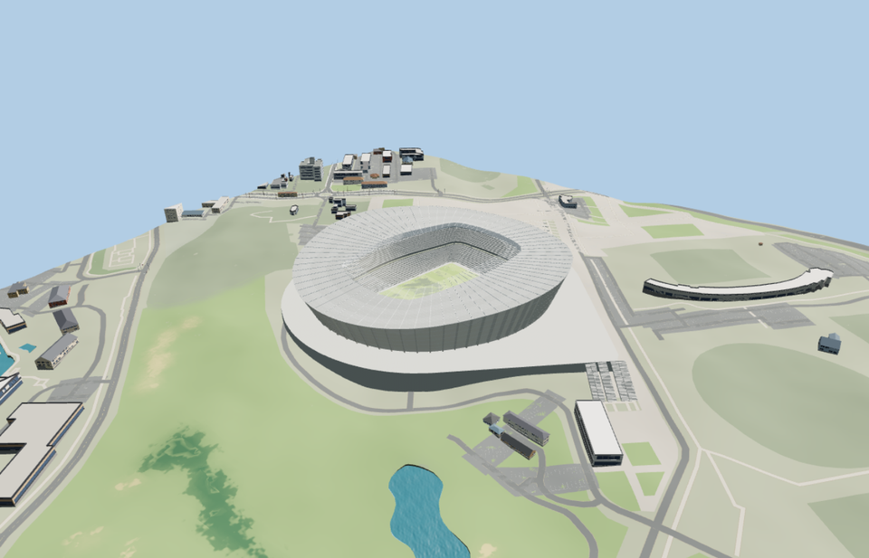

# Cape Town Stadium review

The authored roof and pitch overlap their current PMTiles counterparts by 99.91% and 99.84% respectively, measured as intersection over union. The north-northwest pitch axis and stair banks fix the heading. [Mapped plan](map-frame.json)

The pitch uses the standard Terrarium sample at its center. The 9.9 m podium and 21 reconstructed stair profiles follow the surrounding grade. In the viewer fixture, the stair landings meet terrain within 7 cm across all four detail levels. The pitch remains clear of coarse terrain. The skyline uses simplified stair ramps, and the district level and both nearer levels show the fitted approaches. [Terrain controls](site-grades.json)

The viewer replaced the stadium footprint and retained the 67 neighboring buildings, as well as the roads and water in the sampled area. A failed load restored the original stadium without cutting the terrain. All four levels released their geometry on unload. The source master, imported master, and four detail levels passed Khronos glTF validation. The skyline and district files total 335,276 bytes.

The three-tier bowl, clear inner ring and varying-height silver exterior follow the reference photographs. Stair and podium elevations approximate the standard viewer terrain, and individual seats and roof cables are simplified in the runtime detail levels. Device-specific frame rates remain unmeasured. [Visual review](qa.json) · [Architect’s photographs](https://www.gmp.de/en/projects/501/cape-town-stadium)
