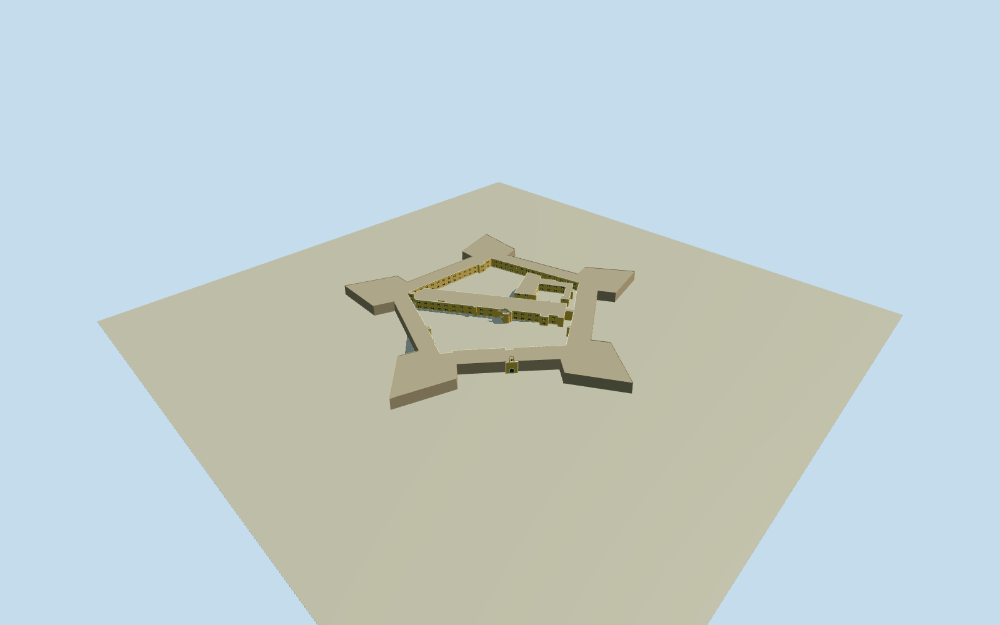

# Castle of Good Hope

Complete surviving five-point star fort on its original native plan: battered plain stone curtains, five angular bastions and low coping, both large open courtyards and small cross-wing void, the independent island wing, recessed ochre courtyard windows/green shutters, northwest arched gateway/open bell chamber and the curved yellow-and-white Kat courtyard pediment with simplified physical heraldic relief.

Authoring state: **review-in-qa.json**. Current completion evidence is in [qa.json](qa.json) and the [completion ledger](../../../../qualla-structures/batches/qualla-002.PROGRESS.md).

- [Castle of Good Hope](https://qualla.com/castle-of-good-hope/)

Original OSM relation57263 and all five named bastion plans control the complete signed star footprint, open courtyard rings, dividing cross-wing and separate island wing. Native bastion8mheight controls the principal wall level; the whole-object13.5mheight is used only as the small gateway/bell maximum. Local wing heights, wall batter, roof/coping thickness and openings are medium-fi estimates, not a measured survey.

The exact published Qualla2006AndrewMassyn public-domain Kat pediment photograph controls its curved yellow crown, white heraldic shield/flags/drums and flanking seated allegorical figures. Its placement is on the central courtyard wing, not the outer entrance. Sculptural anatomy, inscriptions and hidden carving are simplified; no portrait or textual accuracy is claimed.

The exact published Qualla circa1880public-domain original controls plain battered stone curtain typology only. Railway, signals, train, people and the rest of the town are excluded. Gateway/cupola sections, courtyard window/shutter rhythm, local roofs and balcony dimensions are bounded architectural estimates. No disputed atlas image, stylized1689round-fort engraving or non-public-domain photograph is used.

Exterior assembly only; dark recessed portals are closed visual openings, not a traversable interior. Native yards remain genuinely unmeshed voids. Detached city buildings, moat/landscape reconstruction and interiors are excluded. Footings extend.4m below the fixed approach datum; host terrain and yard contact are approximate, with no whole-site platform or source-height fitting.

Build: `node packages/worldgen/scripts/generate-authored-places.mjs --ids=castle_of_good_hope`. Add `--check` to verify exact regeneration. 48765 triangles; 6 materials; no embedded photographs.
