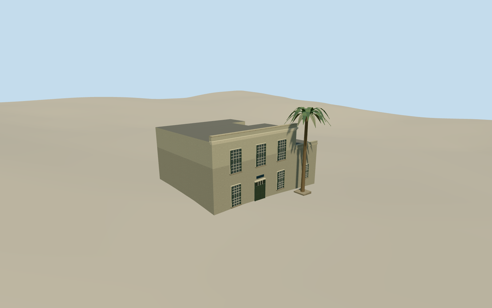

# Palm Tree Mosque

A Cape Georgian house turned mosque with a simple parapet, multi-light sash windows, a low Long Street threshold and one date palm.

Authoring state: **review-in-qa.json**. Current completion evidence is in [qa.json](qa.json) and the [completion ledger](../../../../qualla-structures/batches/qualla-003.PROGRESS.md).

- [Palm Tree Mosque](https://qualla.com/palm-tree-mosque/)

The front uses the original archival elevation. Concealed rear joinery, finishes, roof profiles and planter details are approximate.

The single date palm records the current street context. Its exact position and crown are approximate.

Build: `node content/worldgen/source/places/k3/k3v/palm_tree_mosque/models/generate-palm-tree-mosque.mjs`. Add `--check` to verify exact regeneration. 3186 triangles; 6 materials; no embedded photographs.
