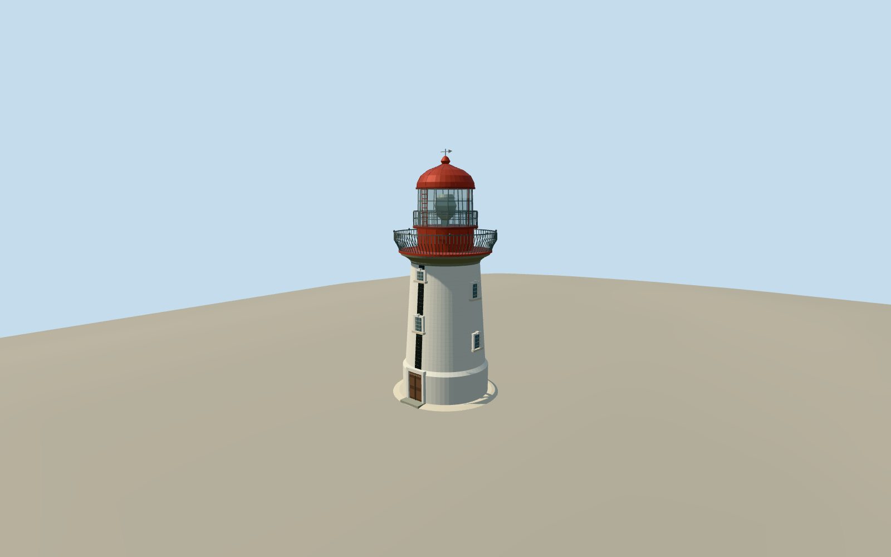

# Robben Island Lighthouse

White tapered masonry lighthouse on Minto Hill, with black east daymark, red service drum and curved dome, two metal galleries and the sixteen-part glazed lantern.

Authoring state: **review-in-qa.json**. Current completion evidence is in [qa.json](qa.json) and the [local 100 ledger](../../../../qualla-structures/batches/PROGRESS.md).

- [Robben Island](https://qualla.com/robben-island/)

Original medium-fi surviving tower exterior, based on an individually inspected 2012 Qualla image and the architect's 2019 northeast photograph; not a surveyed reconstruction.

Published 21.25 m base circumference controls the base diameter. Approximately 18 m tower height excludes the small interpreted weather vane. Other heights, window levels, ladder orientation and ornament are photographic estimates; upper proportions were adjusted against the long-lens Qualla photograph.

Map circle controls the actual Minto Hill location, independently of the island story point. Published coordinates and focal-plane heights differ and are not treated as precise geometry.

Round as-built shaft, staggered sash windows, east door and stripe, curved gallery rails and red lantern/dome are retained. Lens and glazing are visual approximations, not a working navigation light or optical simulation.

Office, engine room, demolished keeper house, paths, shell bollards and vegetation are excluded. No interior stairs or reference image pixels are embedded.

Independent terrain remains unmodified; other runtime elevation datasets can differ at the small foundation.

Build: `node packages/worldgen/scripts/generate-authored-places.mjs --ids=robben_island_lighthouse`. Add `--check` to verify exact regeneration. 15008 triangles; 6 materials; no embedded photographs.
