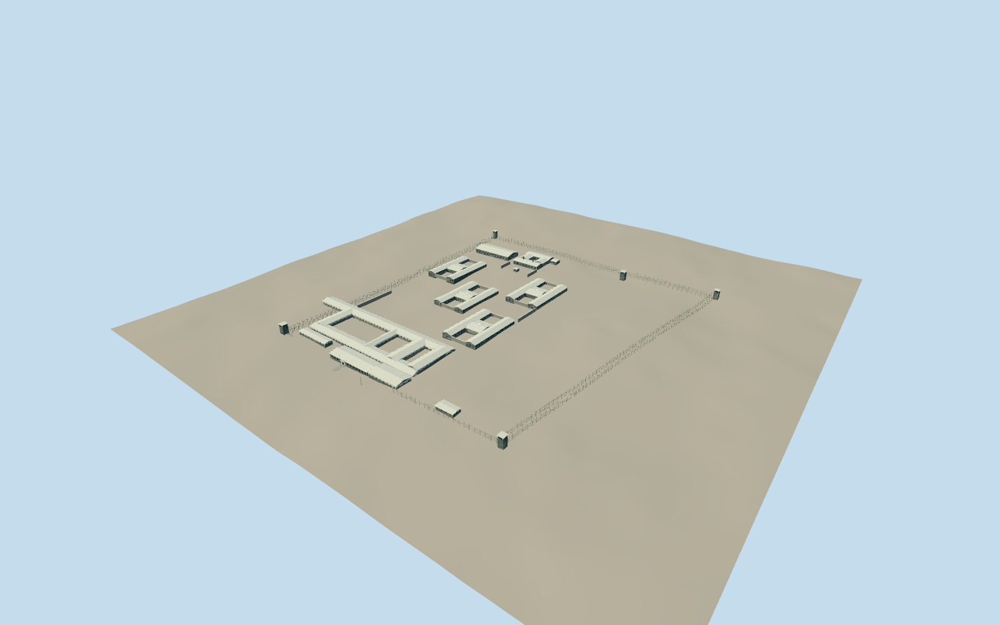

# Robben Island maximum-security prison

Mapped four H-blocks, open isolation courts, blue-stone entrance, light corrugated roofs, service buildings, five watchtowers and the surrounding fence.

Authoring state: **review-in-qa.json**. Current completion evidence is in [qa.json](qa.json) and the [local 100 ledger](../../../../qualla-structures/batches/PROGRESS.md).

- [Robben Island Prison](https://qualla.com/robben-island-prison/)
- [Robben Island](https://qualla.com/robben-island/)

Original medium-fi surviving museum exterior, based on individually inspected 2010–2018 Qualla photographs and mapped footprints; not a site survey.

Four H-blocks, main open courtyards, service buildings and five watchtowers retain their mapped layout. Main roof segmentation, smaller courtyard walls and hidden facade details are interpretations.

Heights, window spacing beyond the photographed entrance and B-section, fence bays and rooftop equipment are photographic estimates. Irregular blue-stone cladding is generalized using authored polygons and shared basalt.

Roof uses a matte corrugated shared surface to represent the observed pale cement sheets; it is not evidence that the original roof is metal.

Kramat, graveyard, other prisons, interiors, exhibits, furnishings and vegetation are excluded. No reference-image pixels are embedded.

Independent terrain is preserved. Whole blocks and towers use fixed locally sampled floor elevations; fences follow the sampled slope. These inferred levels are not a survey, and exact ground contact can differ on another host elevation dataset.

Build: `node packages/worldgen/scripts/generate-authored-places.mjs --ids=robben_island_prison`. Add `--check` to verify exact regeneration. 63280 triangles; 6 materials; no embedded photographs.
