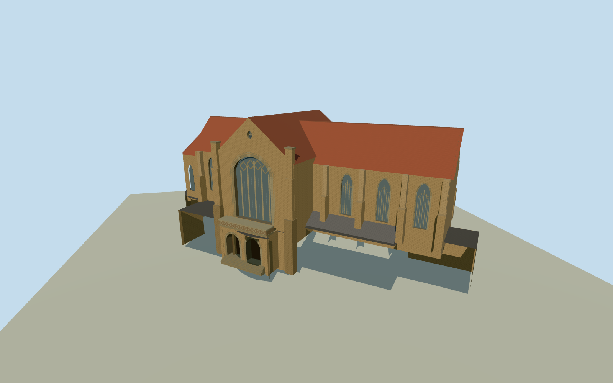

# St. George's Cathedral, Cape Town

St. George’s Cathedral in Cape Town, with the stone Wale Street transept and paired porch, steep red roofs, pointed clerestory and rounded chancel end.

Authoring state: **review-in-qa.json**. Current completion evidence is in [qa.json](qa.json) and the [completion ledger](../../../../qualla-structures/batches/qualla-003.PROGRESS.md).

- [St. George's Cathedral, Cape Town](https://qualla.com/st-george-s-cathedral-cape-town/)

The model represents the named cathedral as seen in its 2006 Wale Street photograph. The projecting transept, twin entrance porch, tracery and buttresses are modeled directly from the published visual reference.

Roof heights and unphotographed south and chancel details use estimates. The lower exterior uses the modern mapped outline and original terrain.

Stone courses and leaded tracery are simplified at exterior viewing scale. The crypt and other interior spaces are outside this model.

Build: `node content/worldgen/source/places/k3/k3v/st_george_s_cathedral_cape_town/models/generate-st-georges-cathedral-cape-town.mjs`. Add `--check` to verify exact regeneration. 3170 triangles; 6 materials; no embedded photographs.
