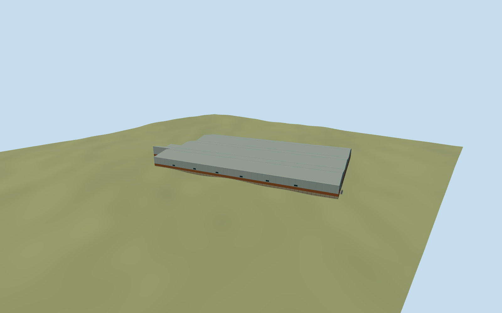

# Outeniqua Transport Museum

The former PX goods shed in George: its long, shallow metal roof, corrugated walls, rail bays and brick museum entrance.

Authoring state: **review-in-qa.json**. Current completion evidence is in [qa.json](qa.json) and the [completion ledger](../../../../qualla-structures/batches/qualla-003.PROGRESS.md).

- [Outeniqua Transport Museum](https://qualla.com/outeniqua-transport-museum/)

The named OSM envelope is used in full. George Municipality’s two matching 2026 building polygons independently check the main shed length, span and small returns.

The roof pitch and three spans, exact gates, entry facade openings and material colors are estimates. The public-domain photo constrains the rail-side cladding and visible trim only. Possible storm repairs and the status of verandah additions are not modeled.

The original terrain samples stay unchanged. The finished floor, individual thresholds and apron heights are approximate.

Build: `node content/worldgen/source/places/k3/k3z/outeniqua_transport_museum/models/generate-outeniqua-transport-museum.mjs`. Add `--check` to verify exact regeneration. 1542 triangles; 7 materials; no embedded photographs.
