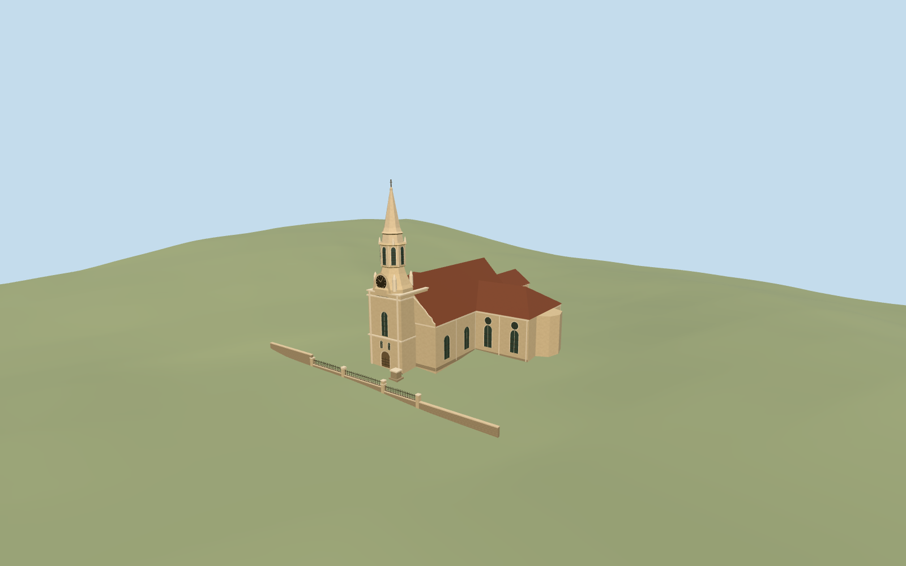

# Dutch Reformed Church, Wellington

Wellington’s Dutch Reformed Mother Church with a ring-wall entrance, pale clock tower and needle spire, ruddy cross roofs and long arched windows.

Authoring state: **review-in-qa.json**. Current completion evidence is in [qa.json](qa.json) and the [completion ledger](../../../../qualla-structures/batches/qualla-003.PROGRESS.md).

- [Dutch Reformed Church, Wellington](https://qualla.com/dutch-reformed-church-wellington/)

The native building perimeter and surveyed spire position constrain the model. Roof pitches, middle tower tier heights and minor facades are approximated.

The survey point lies just beyond the general wall outline at the church front. The modeled tower carries a small separately defined projection centered on the surveyed point. The vertical height uses the source terrain at the site and the surveyed top elevation as a target.

The model includes the front ring wall and its gate pier rhythm. The cemetery interiors and museum furnishings are outside scope. A simple pedestal marks the named memorial without reconstructing its sculptural figure.

Only the verified 2007 Qualla photo was used. Its evening color cast is interpreted as a neutral pale warm stucco for the Earth scene.

Build: `node content/worldgen/source/places/k6/k6j/dutch_reformed_church_wellington/models/generate-dutch-reformed-church-wellington.mjs`. Add `--check` to verify exact regeneration. 4906 triangles; 6 materials; no embedded photographs.
