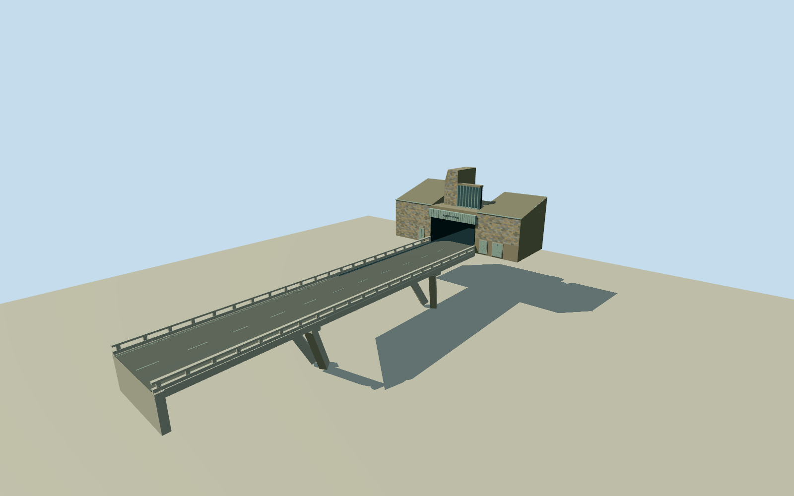

# Huguenot Tunnel — eastern portal

Photo-guided operating eastern portal: asymmetric multicolor small-stone wings with sloping roofs, stepped high ventilation cheek and pale vertical fins, genuinely open rectangular road mouth with oxidized metal fascia/raised HUGENOTE-TONNEL lettering, small service doors and native65.98mconcrete approach bridge with slit parapets and angled supports. Native operating tunnel endpoint/bearing distinguish the separate unused NorthBore. Underground bore/mountain and other end excluded.

Authoring state: **review-in-qa.json**. Current completion evidence is in [qa.json](qa.json) and the [completion ledger](../../../../qualla-structures/batches/qualla-002.PROGRESS.md).

- [Huguenot Tunnel](https://qualla.com/huguenot-tunnel/)

Original named N1operating tunnelway52435898/Q4993604ends exactly at east approachbridgeway137438581. Separate unused/private northern boreway363782330is retained as identity exclusion. Native line gives the portal center, road bearing and actual bridge span; no native portal building footprint/height exists, so wings/vent geometry and deck/support sections are photographic estimates.

Exact full3648x2736ZaianCC0Quallaoriginal controls the operating northeastern/eastern portal, not the separate unfinished NorthBore. Complete wing envelope, roughly32.5mwide facade/16.7mhigh ventilation cheek,11.5mroad mouth, roof pitch, fins and concealed rear/side sections are photographic medium-fi estimates; no measured architectural survey is claimed.

The original native attached bridge centerline fixes65.984mspan/axis.12.3mdeck width, slab/parapet sections and two pairs of battered supports are photographic interpretations; exact support count/positions/feet and rock attachment remain approximate. Thin facade cladding colors are original deterministic geometry over shared ashlar, not sampled photo texture.

Eastern portal/approach exterior only. Rectangular road mouth is physically open to a short17mdark-lined visual recess with closed far end; no traversable3.9kminterior, western portal, unused NorthBore, mountain mesh, tunnel-terrain cutting, toll plaza, vehicles, signs/cameras or detached roadside buildings. Existing surface terrain is preserved, so host-specific tunnel-mouth cutting is separate from this preview.

A fixed eastern approach abutment defines approximate deckY0 before elevation sampling. Precise road gradient and underdeck support/ground contact remain host-dependent and unverified; no whole-mountain flattening/platform. Fine cladding patches, fascia lettering/seams, doors and open parapet slits simplify with distance.

Build: `node packages/worldgen/scripts/generate-authored-places.mjs --ids=huguenot_tunnel`. Add `--check` to verify exact regeneration. 5370 triangles; 6 materials; no embedded photographs.
