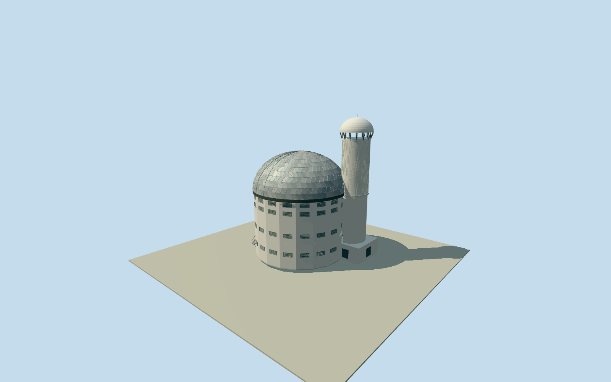

# Southern African Large Telescope

Whole SouthernAfricanLargeTelescope/SALT Q833639 nativeway1234094999/all29uniquenativefootprintcontrols, main cylindrical white observing building with repeated real recessed metal louvres, full closed silver polygon-panel observingdome/darkrim, attached tall ribbed ventilationtower with smaller domedcap/open overhang brackets, boundedlow intrinsicservice/visitor annex and exterior accessstairs/ladder/balcony. Whole telescopebuilding, no facade-only orgeneric observatorysphere. Preserve full native footprint including towerprojection and visible lowannex; unseen back/aperture mechanism/louvre census/sections original boundedestimates. Exclude otherSAAO observatory telescopes/wholecampus/roads/ground/landscape/private optical instrumentation/interiors/signs/lettering/people.

Authoring state: **review-in-qa.json**. Current completion evidence is in [qa.json](qa.json) and the [completion ledger](../../../../qualla-structures/batches/qualla-002.PROGRESS.md).

- [Southern African Large Telescope](https://qualla.com/southern-african-large-telescope/)

Exact named SALT buildingway1234094999/Q833639/telescopeopticaldiameter11 confirms telescope identity, distinct entireSAAOobservatoryway139666351/Q116161487. All29native boundarycontrols cover maincylinder andattachedsmallround ventilationtower; anchorfixed wholebbox midpoint/+Xeast/+Zsouth/heading0. Dome/panel detail andvisible lowannex bounded to entiremainbuilding; no neighboring smaller telescope adopted. Body18outercontrols andtower11nativecontrols retained; missingcirclearc behindattachedtower estimated continuously. Heights/aperturemechanism andhiddenvent census unknown.

Independent400m129x129field/16641samples/one rawTerrariumtile frozen before floor/height/dome/sections. FixedSWdatum1753.5394m/floor0 is unsurveyedproviderrelative reference, not story1837mabsolute or fittedthreshold. Original18mwhite drum/10.2mshallowhemisphericalpolygonpaneldome/.65mrim/32.5mventilationshaft/34.2mcapbase+3.65mrise/7mlowannex deriveboundedphotoproportions versus25.6mnativebodywidth. All29nativewholefootprintcontrols retained, smallvisibleprojection1.5m bounded. Closed-daytime dome/shutterseam; hiddenvent/windowcensus/shaftcapbrackets/externalstairs/mechanics/currentfinish originalestimates. Fieldunchanged; hostcontact/replacementfalse.

Whole original observingbuilding/native29control base/main whitecylinder/silvertriangularpolygonpaneldome/darkrim/attachedtall ribbedventilationtower/smallroundcap/openundersidebrackets/lowvisitorserviceannex/exteriorstairs andladder. Allnativewholefootprintcontrols retained atallLODs; nativecirclecoarseness remains. FullsurvivingSALT only, separateSAAOcampus andotherinstruments excluded.

Exact1704x2272 Siener2006-09-23 Own/PD-self Qualla original724306bytes/nativeSHA1matched, personallyinspected. No supplementalphotos/interior mirror/photo textures/generatedbitmaps. Closed-daytime dome representsobservatoryatrest, not a fabricatedopen instrumentinterior; panels andtwo closedshutterrails original bounded exterior estimates, no claim ofexactoperatingstate.

Nativefootprint supplieswholebody/attachedtower positionandextent, not surveyed elevations/domeprofile/shuttermechanism/louvrecount/annex/stair sections/currentfinish. Main18mwall/10.2mdomerise/tall32.5mshaft/34.2mcapbase/3.65mroundcap andhiddenbackventcensus originalphotoproportion estimates; mirror11mdiameter never substitutedforbuildingwidth. Lowerannex bounded1.5mprojection, no surroundingcampus geometry.

Independent400m129x129field/16641samples/one rawTerrariumtile frozen beforefloors/geometry. FixedSWdatum1753.5394m/floor0 providerrelative, not story1837mengineeringdatum. Groundgrid/PNG/rawsource unchanged; precise threshold/foundation/annex/stair contact unresolved, geographicpreview/replaceFootprintfalse. Portable/context flatreviewground a separate diagnosticfixture, no artificialmountaintop/platform orfittednativegrade.

Build: `node packages/worldgen/scripts/generate-authored-places.mjs --ids=southern_african_large_telescope`. Add `--check` to verify exact regeneration. 43923 triangles; 5 materials; no embedded photographs.
