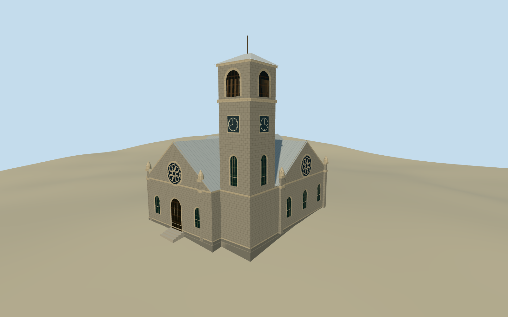

# Dutch Reformed Church, Springbok

Springbok’s granite Klipkerk with its paired rose-window gables, silver standing-seam roofs, square clock tower and low stair turret.

Authoring state: **review-in-qa.json**. Current completion evidence is in [qa.json](qa.json) and the [completion ledger](../../../../qualla-structures/batches/qualla-003.PROGRESS.md).

- [Dutch Reformed Church, Springbok](https://qualla.com/dutch-reformed-church-springbok/)

The exterior is based on the documented street and side elevations. The tower height, rear opening rhythm and roof junctions are approximate.

The rose tracery, clock numerals, metal seams and rough masonry profiles are simplified at this scale.

Build: `node content/worldgen/source/places/k6/k6s/dutch_reformed_church_springbok/models/generate-dutch-reformed-church-springbok.mjs`. Add `--check` to verify exact regeneration. 2749 triangles; 6 materials; no embedded photographs.
