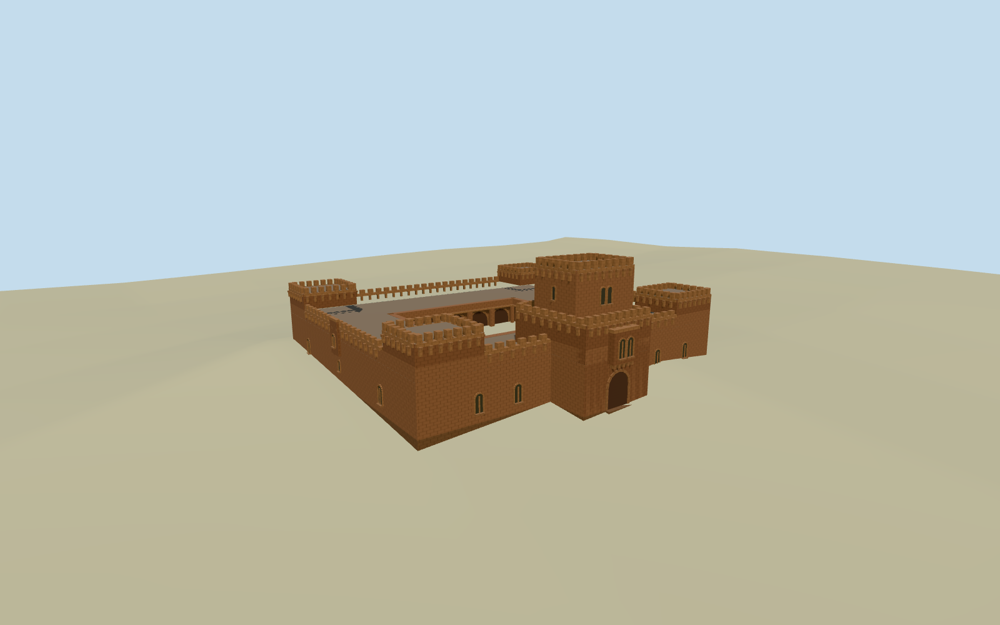

# Duwisib Castle

Duwisib Castle in local red sandstone, with four square crenellated corners, a tall oriel entrance and an arcaded central courtyard.

Authoring state: **review-in-qa.json**. Current completion evidence is in [qa.json](qa.json) and the [completion ledger](../../../../qualla-structures/batches/qualla-004.PROGRESS.md).

- [Duwisib Castle](https://qualla.com/duwisib-castle/)

The outer walls and exterior details are the focus. Courtyard dimensions, roof slopes, rear shading and restoration finishes are approximate.

Interiors, detached farm buildings and the riding arena are outside the placement.

Build: `node content/worldgen/source/places/k7/k7e/duwisib_castle/models/generate-duwisib-castle.mjs`. Add `--check` to verify exact regeneration. 11635 triangles; 6 materials; no embedded photographs.
