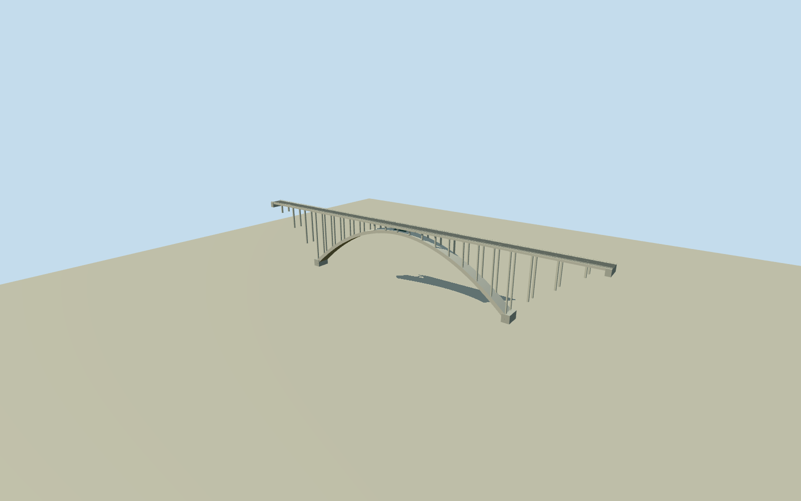

# Bloukrans Bridge

451m N2 concrete deck arch bridge with272m single broad arch, approximately62m arch rise, paired open vertical spandrel columns, approach piers and abutments, two-lane charcoal roadway, pale slotted concrete parapets, narrow under-deck catwalk and central bungee platform. River gorge and detached visitor buildings are excluded;216m river clearance is a site fact, not an invented line of tall piers.

Authoring state: **review-in-qa.json**. Current completion evidence is in [qa.json](qa.json) and the [completion ledger](../../../../qualla-structures/batches/qualla-002.PROGRESS.md).

- [Bloukrans Bridge](https://qualla.com/bloukrans-bridge/)

Primary ACI1981 construction abstract and Qualla agree on451m total length,272m arch span and216m river clearance. Native mapped bridge centerline includes about12m of end transition beyond the reported bridge length; it controls centroid/heading, not a rescaling of the whole structure.

Two inspected public-domain NJR ZA Qualla originals control the single broad concrete arch, repeated paired columns, slab/parapets and under-deck bungee platform. Rise,16m width, precise bay count, section thickness, hidden faces, platform/catwalk dimensions and bank-pier foundations are photographic medium-fi estimates. No engineering drawing or non-public-domain imagery used.

Static exterior only: no traffic, people, operator logos, active bungee ropes or detached visitor facilities. No navigable internal structural box or engineering-grade collision.

Bank reference and source terrain are approximate. Actual216m gorge/forest/river are supplied by the host landscape, not authored into the bridge. Gorge/rock contact is not surveyed and no source elevation is fitted to the model. Original photos remain in Qualla and are not textures.

Build: `node packages/worldgen/scripts/generate-authored-places.mjs --ids=bloukrans_bridge`. Add `--check` to verify exact regeneration. 9700 triangles; 3 materials; no embedded photographs.
