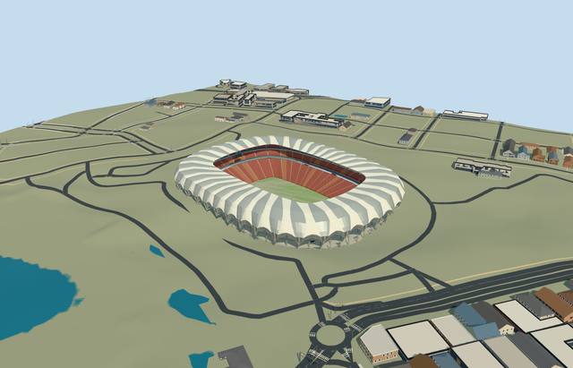

# nelson_mandela_bay_stadium — Nelson Mandela Bay Stadium

Reviewed 2026-10-20 in one continuous author/build/inspect/fix round.

## Appearance

Inspected49 current portable/shared/medium-fi/native-site views in the same ordinary-picture/map/build/inspect/fix pass, including full-sized facade/bowl and an additional targeted view under the canopy. Specific scalloped rounded rectangular flower roof/open central field, closed curved pale metal petals/alternating membrane skins/renderable underside and connected three-chord truss approximations, two-level open colonnades/concrete galleries/glazed box band/recessed closed services/entry-flight approximations, broad red/warm lower tier/two narrower upper bands/aisles/hospitality belts, supported sunken neutral football floor/goals and roof-hung neutral displays/lights. Corrected unintended native-zigzag folds by smoothing only the roof envelope beneath36 near petals, refined red seating risers and retained original native outline as map evidence. Matching skins/roof material seams have no visible missing side. No generic flat roof, neighboring site/whole-lake platform, crowd/branding or furnished offices.

## Shared materials and browser levels

Five existing256-square graphs: concrete_plain, metal_painted, metal_standing_seam, window_grid and fabric_canvas. Concrete supplies foundations/open galleries/piers/tier aisles and flight approximations; palette-tinted paint supplies pale trusses/red/warm seat surfaces/recessed service fronts/neutral markings/screens; standing-seam approximates corrugated petal cladding; window-grid supplies closed glazed box/hospitality bands; canvas supplies quiet pale membrane and approximate turf grain. Five near draws; zero embedded images/unique atlas/copied photograph pixels. Metric shared repeats/linear palette tints; each nearby graph loaded once. Separate POSITION/NORMAL buffer views and equal reported CPU/GPU geometry bytes; unload releases geometry. Pale membrane is opaque double-skinned geometry, not simulated optical transmission; common glazing/corrugation are medium-fi approximations.

| Level | Triangles | Bytes | Draws |
| --- | ---: | ---: | ---: |
| skyline | 928 | 88508 | 1 |
| district | 3794 | 371560 | 5 |
| street | 15210 | 1488288 | 5 |
| closeup | 62442 | 6380788 | 5 |

Inspected24 current context/mode/silhouette/matched-level/transition frames at noon/late afternoon in Economy/High. Every level retains open flower roof/bowl and red seating bands. Near levels retain36 petals and refine curvature, trusses, aisles/treads/risers/columns/recessed entries; skyline deliberately coarsens to12 broad petal groups. District/street merge structural chord/step detail. Levels928/3794/15210/62442triangles; initial skyline plus district460068bytes, at most five draws. Synthetic neighbors do not prove geographic placement. Physical ordinary-laptop/phone/dense-city timing remains pending. Levels928/3794/15210/62442 triangles; at most five draws.

## Approximate map fit

Exact-QID OSMway27345494 identifies this stadium. Two standard PMTiles parents52776559085409/52776560441972 share the scalloped outer roof with different holes; both same-stadium records are replaced with zero remainder/visible old shell. Own anchor[25.599423578009755,-33.937793945152094]/heading0/native east-south, internal X[.20344670661719153,-.9790860215357068]/Z[.9790860215357068,.20344670661719153] follows175.558420x115.384240m roof aperture. Smaller hole at83percent informs the lower bowl surround; pitch stays105x68m. Smoothed radial envelope/36 near petal allocation and fine20degree/2m facade facing are approximate, not a whole leisure/plaza boundary. All105 independent resident inputs of107 originals/197 wider records, original6m terrain/native roads and342974.41935542005m2 lake water unchanged. Each colonnade pier crosses its retained native contact. Working fieldY-6/bounded occupied floor/retaining perimeter plus opening inside90percent body/common supported floor handle coarse ground without original sample/outside/water edits. Failure keeps107 originals and original ground; every level unload restores ground/water/zero live model geometry.

## Limits

Six ordinary gmp project photographs actually viewed: expanded aerial, lake facade, metal petal close-up, roof/gallery underside, entrance/colonnade detail and empty red bowl. Project2009/photo exposure dates unspecified; Marcus Bredt/Grinaker-LTA credited on page, individual image attribution not separated. Copyright retained/viewed only; no pixels copied. Pictures do not establish later changes/current condition/equipment. No qualified heights: field6m below coarse anchor grade, roof about17..41m above field including petal crown, upper seating31.5m, outer box16..20.5m and colonnade bands8/15.6m are visualization estimates.36 near petals, precise folding/chord/perforation/seat/portal/flight inventory and20degree/2m facing are approximate; no concealed furnished interior/access slope/engineering capacity/demounting claim. Raw anchor17.5785010484427m/per-column sample offsets are coarse standard-terrain contacts, not a surveyed foundation or real excavation. Membrane opaque/corrugated cladding/window/turf textures approximate shared finishes; no optical transmission simulation. Neutral football layout excludes event-specific equipment/crowd/artwork. Whole lakeside/parking/landscape remains native. Physical phone/laptop/dense-city performance remains unmeasured.

## Selected checks

Six Khronos files: zero errors/warnings.9712 actual mesh/material/contact checks; 49 current inspected views. Scene validation/sim30 and strict selected medium-fi audit pass. Source/runtime/LOD hashes and material bindings verified.

Rebuild: node packages/worldgen/scripts/generate-additional-landmarks.mjs --ids=nelson_mandela_bay_stadium; node packages/worldgen/scripts/import-structure-models.mjs --ids=nelson_mandela_bay_stadium; node packages/tooling/scripts/generate-landmark-lods.mjs --ids=nelson_mandela_bay_stadium --force.

Source: sha256:66516b6c31df8660013a312dbd3672444131e0aab5195a20cc025f8ae73cbb00

Runtime: sha256:e71b27794d54fdb3d5daf3abea3563973864a9f9c628229d8b236fe4e9896bc8

Input: sha256:b27ff57857b58fbb35d151198684e3446fa2d01d2f8607709b709304212af414

## Viewed ordinary pictures

https://www.gmp.de/en/projects/516/nelson-mandela-bay-stadium — Gallery1: complete aerial stadium and North End Lake; Marcus Bredt and Grinaker-LTA credited on gmp project page; individual image attribution not separated; Copyright retained by rights holders; viewed only/no pixels copied. Viewed only; no pixels copied.

https://www.gmp.de/en/projects/516/nelson-mandela-bay-stadium — Gallery2: lake-facing full exterior; Marcus Bredt and Grinaker-LTA credited on gmp project page; individual image attribution not separated; Copyright retained by rights holders; viewed only/no pixels copied. Viewed only; no pixels copied.

https://www.gmp.de/en/projects/516/nelson-mandela-bay-stadium — Gallery3: close curved metal petal ends; Marcus Bredt and Grinaker-LTA credited on gmp project page; individual image attribution not separated; Copyright retained by rights holders; viewed only/no pixels copied. Viewed only; no pixels copied.

https://www.gmp.de/en/projects/516/nelson-mandela-bay-stadium — Gallery4: open gallery under roof; Marcus Bredt and Grinaker-LTA credited on gmp project page; individual image attribution not separated; Copyright retained by rights holders; viewed only/no pixels copied. Viewed only; no pixels copied.

https://www.gmp.de/en/projects/516/nelson-mandela-bay-stadium — Gallery5: exterior colonnade/entrance; Marcus Bredt and Grinaker-LTA credited on gmp project page; individual image attribution not separated; Copyright retained by rights holders; viewed only/no pixels copied. Viewed only; no pixels copied.

https://www.gmp.de/en/projects/516/nelson-mandela-bay-stadium — Gallery6: complete empty red bowl; Marcus Bredt and Grinaker-LTA credited on gmp project page; individual image attribution not separated; Copyright retained by rights holders; viewed only/no pixels copied. Viewed only; no pixels copied.
