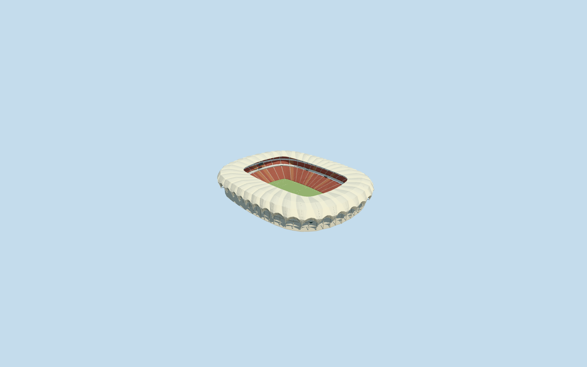

# Nelson Mandela Bay Stadium

Specific Nelson Mandela Bay Stadium: mapped scalloped rounded rectangular flower roof/open central field, curved closed opaque metal petals and alternating closed pale membrane fields/renderable underside/three-chord truss approximations, two-level open colonnade/pale concrete galleries/dark glazed box band/closed recessed services and entries, broad red/warm lower seating tier/two narrower upper bands/aisles/hospitality belts, bounded supported sunken football floor/markings/goals and roof-hung neutral end displays/lights. Five existing shared concrete/paint/standing-seam/window-grid/canvas graphs. No generic smooth roof, field roof, whole lakeside/plaza slab, copied branding/crowd or furnished service interiors.

## Evidence and reconstruction

Published dimensions and reconstructed details are separated in spec.json. Primary references:

- [Reference](https://www.gmp.de/en/projects/516/nelson-mandela-bay-stadium)

Specific Nelson Mandela Bay Stadium: mapped scalloped rounded rectangular flower roof/open central field, curved closed opaque metal petals and alternating closed pale membrane fields/renderable underside/three-chord truss approximations, two-level open colonnade/pale concrete galleries/dark glazed box band/closed recessed services and entries, broad red/warm lower seating tier/two narrower upper bands/aisles/hospitality belts, bounded supported sunken football floor/markings/goals and roof-hung neutral end displays/lights. Five existing shared concrete/paint/standing-seam/window-grid/canvas graphs. No generic smooth roof, field roof, whole lakeside/plaza slab, copied branding/crowd or furnished service interiors.

## Model and axes

62,442 triangles; 187,326 vertices; 5 material groups; 7,496,496 bytes. Native bounds: -112.231, -6.800, -134.792 to 107.771, 34.755, 134.844. Source hash: `sha256:66516b6c31df8660013a312dbd3672444131e0aab5195a20cc025f8ae73cbb00`.

{"x":"east","y":"up","z":"south"}

The geographic proposal uses exact-QID OpenStreetMap evidence. Map-derived orientation and estimated architectural details require real-site visual review; preview eligibility is distinct from geographic/fidelity approval. Map attribution: © OpenStreetMap contributors, ODbL-1.0.

## Reproduce

Run `node packages/worldgen/scripts/generate-additional-landmarks.mjs --ids=nelson_mandela_bay_stadium` (or add `--check`). The generator preserves manually edited masters by checking their baseline hashes. Import through the standard authored-model workflow with optimization disabled; then capture all QA cameras, including shared-surface views.

## Pending work

- Specific Nelson Mandela Bay Stadium: mapped scalloped rounded rectangular flower roof/open central field, curved closed opaque metal petals and alternating closed pale membrane fields/renderable underside/three-chord truss approximations, two-level open colonnade/pale concrete galleries/dark glazed box band/closed recessed services and entries, broad red/warm lower seating tier/two narrower upper bands/aisles/hospitality belts, bounded supported sunken football floor/markings/goals and roof-hung neutral end displays/lights. Five existing shared concrete/paint/standing-seam/window-grid/canvas graphs. No generic smooth roof, field roof, whole lakeside/plaza slab, copied branding/crowd or furnished service interiors.
- Retained exact-QID OSMway27345494 identifies the individual stadium. Standard PMTiles parents52776559085409/52776560441972 retain the same scalloped outer roof with two central holes. Own anchor[25.599423578009755,-33.937793945152094]/heading0/native east-south; internal X[0.20344670661719153,-0.9790860215357068]/Z[0.9790860215357068,0.20344670661719153] follows the175.558420x115.384240m larger roof aperture. Smaller retained opening informs the lower bowl surround at83percent; neutral105x68m pitch is not stretched to building/roof size. Complete petal envelope and ordinary aerial/exterior/empty-bowl pictures control unique form. Petal/facade inventory/fine entrances retain20degree/2m uncertainty, not a signed facade survey.
- No qualified mapped architectural heights. Field working6m below anchor grade; roof17..40m above field, upper seating30m, glazed outer box16..20.5m, colonnade floors8/15.6m and36 near petals are ordinary-picture/native-plan visualization allocations, not measured structural dimensions or real excavation depths. Exact petal count/folding/corrugation, structural chords, seat/aisle/portal/step inventory and20degree/2m facing are approximate. Glazing/membrane/turf use quiet existing materials; membrane is represented by opaque double-skinned geometry, not optical transmission. Appearance follows2009-era gmp pictures; later changes/current equipment/condition are unverified. No access/engineering certification or concealed furnished interior claim.
- Original standard6m Mapzen ground/native roads/lake and unrelated building inputs remain unchanged. Anchor sample defines modelY0; field workingY-6 is a picture-led relative allocation, not a surveyed excavation. Occupied retaining floor/perimeter and each local column contact use retained samples. Bounded opening inside90percent mapped body/common supported floor reveals the sunken bowl without modifying source samples/outside terrain/water. Only both same-stadium parents are replaced; no whole plaza platform/flattening or water cutout. Failure/unload restore original ground/context.

This bundle follows the medium-fi standard. Medium-fi appearance and geographic fit are reviewed separately. Hash-bound visual acceptance is recorded separately after capture inspection.
